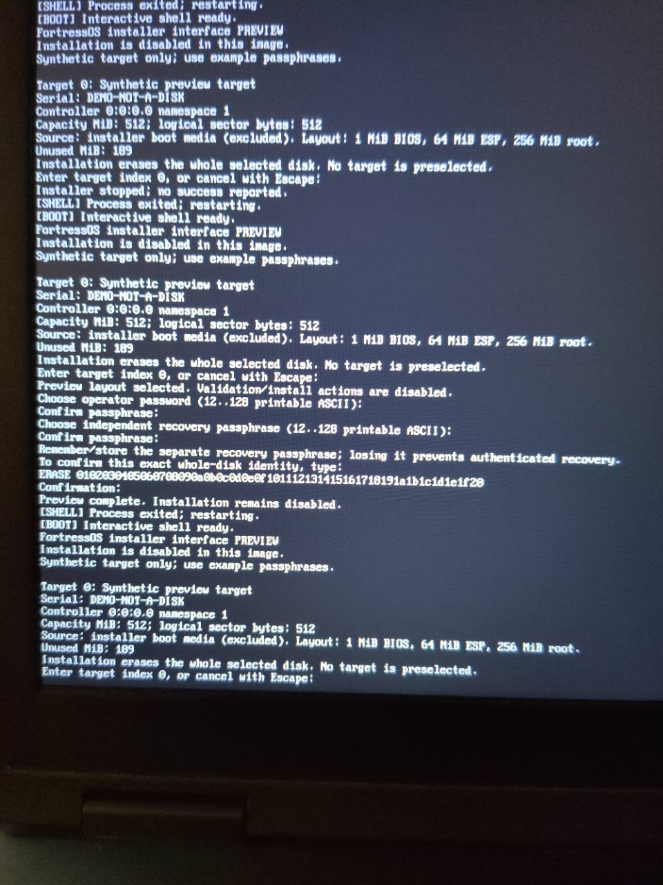

# Dell installer interface preview

Use `bin/fortress-installer-preview.iso` (about 9 MiB), not the disposable installation
workbench image. This preview shows a synthetic 512 MiB target named
`DEMO-NOT-A-DISK`. The interface never calls INSTALLCTL, the kernel is built
without TEST_INSTALLER, and installation payload modules are omitted. Even the
final confirmation ends with “Preview complete. Installation remains disabled.”
The disk displayed is not the Dell's actual disk.

1. Put the preview `.iso` on a spare USB stick with Rufus, selecting ISO image
   mode when prompted. This extracts the boot files onto the USB filesystem.
   Select the USB stick carefully: flashing replaces its contents.
2. Connect it to the Dell, power on, and press F12.
3. Choose the UEFI USB entry. Secure Boot must be disabled for this unsigned OS.
4. Let the preview menu boot. At the installer prompt, enter `0`.
5. Use example passphrases such as `demo-operator-passphrase` and
   `demo-recovery-passphrase`, confirming each. Input is deliberately hidden.
6. You can inspect the final confirmation or type the displayed confirmation
   to see the disabled completion screen. Escape cancels a prompt.
7. Power off and remove the USB stick when finished.

This is interface acceptance only. Physical installation and full Phase 4
acceptance remain separate work.

Reproduction uses an isolated snapshot from
`scripts/create_ext4_guest_workspace.py`, built with no INSTALLER_TEST option:

```sh
make -C "$workspace" -j4 bin/fortress.elf bin/initramfs.tar build/tool-install-preview.elf
python3 scripts/create_installer_media.py --preview \
  --kernel "$workspace/bin/fortress.elf" \
  --bootstrap "$workspace/bin/initramfs.tar" \
  --installer "$workspace/build/tool-install-preview.elf"
python3 scripts/test_installer_preview.py --media "$retained_media_directory" --iso
```

The ISO guest gate boots under BIOS and UEFI with a writable
regular-file NVMe sentinel, completes every prompt, and verifies whole-image
hashes of both the sentinel and source remain unchanged. Logs, command arguments,
screenshots and hashes are retained under `build/root-phase4/preview-*`.

The separately generated raw FAT image passes BIOS USB boot. Initial OVMF
USB boot with QEMU xHCI stalled before kernel entry under KVM and TCG; those
interrupted attempts are retained. On 2026-10-12 the same raw preview image
passed BIOS/UEFI through EHCI, isolating the problem to the xHCI preboot fixture.
Physical Dell interface verification passed by user-provided photos on
2026-10-11: target selection, password/confirmation prompts, rejection of an
identical recovery secret, exact final confirmation, and “Preview complete.
Installation remains disabled.” The supervisor then restarted the preview.
This verifies the interface only; no installation or physical disk integrity
audit is claimed. The ISO extraction
route remains the tested Dell preview transport. For identifying a real spare
NVMe, use the separate [identity-only inspection image](plans/PERSISTENT_ROOT_PHASE5.md).


