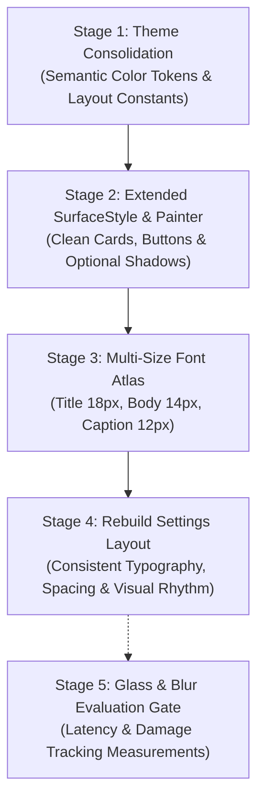

# FortressOS Desktop UI Improvement Plan

## 1. Overview and Invariants

This plan outlines the visual modernization of the FortressOS desktop interface, covering `user/libui`, the compositor, and the built-in Settings application.

### Key Principles and Guardrails
- **No Unsolicited Functionality**: Keep new functionality out of this redesign. Power-mode selection, wallpaper previews, and timezone presets appear only if their underlying backend behavior already exists.
- **Typography and Spacing Linked**: Finalize font metrics (Title 18px, Body 14px, Caption 12px) before fixing card heights and page layouts.
- **Optional Shadows**: Extend the existing shadow renderer and measure redraw/damage costs before adding shadows to cards.
- **Preserve Test Intent**: Maintain behavioral, input, clipping, and damage tracking invariants. Update visual/golden fingerprints only after inspecting and verifying rendered output.
- **Separate Approval Gate for Blur**: Stages 1–4 comprise the core project. Stage 5 delivers cost and latency measurements before any blur or glass effects are enabled.
- **Zero Allocations & Bounded State**: `#![no_std]`, zero heap allocation in widget rendering, bounded dirty rect tracking, integer-only arithmetic.
- **System Boundaries**: Preserve root display authorization, packaging boundaries, keyboard navigation (`Tab`, `Enter`, `Escape`), and CPU-0 networking/Wi-Fi contracts.

---

## 2. Staged Roadmap

---

### Stage 1: Consolidating Colors and Visual Constants into a Shared Theme
- **Scope**:
  - Unify palette tokens in `user/libui/src/theme.rs` and re-export in `user/compositor/src/theme.rs`.
  - Provide structured surface, border, text, and status colors.
  - Define standard layout spacing, corner radiuses, and control heights.
  - Eliminate scattered ad-hoc magic color literals in `user/compositor/src/ui.rs` and `desktop.rs`.
- **Verification**:
  - `make test-libui-host` (8/8 PASS).
  - `make test-compositor-host` (81/81 PASS).

### Stage 2: Extending `SurfaceStyle` and `Painter` APIs
- **Scope**:
  - Extend `SurfaceStyle` with configurable corner radiuses, refined top highlight bevels, and optional shadow elevation parameters.
  - Add unified drawing helpers to `Painter`: `card()`, `card_elevated()`, `button_styled()`, and standard dividers.
  - Measure redraw and damage footprint of card elevation before applying shadows broadly.
  - Reuse `libui::Painter` inside `user/compositor/src/ui.rs` to avoid duplicated raster loops.
- **Verification**:
  - Unit tests in `user/libui/tests/host_tests.rs`.
  - Damage calculation and clipping validation in `tests/compositor_host.rs`.

### Stage 3: Multi-Size Pre-rasterized Font Atlas (Title 18px, Body 14px, Caption 12px)
- **Scope**:
  - Update `scripts/build_compositor_font.py` to bake DejaVu Sans (licensed under `user/libui/assets/DejaVu-LICENSE.txt`) into 3 atlases:
    - Title: 18px font size, 22px line height (`ui-title-alpha.bin`, `ui-title-advances.bin`).
    - Body: 14px font size, 18px line height (retaining `ui-alpha.bin` for 100% backward compatibility).
    - Caption: 12px font size, 15px line height (`ui-caption-alpha.bin`, `ui-caption-advances.bin`).
  - Extend `libui::font` with `FontSize` enum while keeping existing functions pointing to `Body`.
  - Add `Painter::title()` and `Painter::caption()`.
  - Verify readability at native 1080p and 2× UHD scaling.
- **Verification**:
  - Font metric, advance width, and clipping tests in `host_tests.rs`.
  - Verify zero impact on external standalone binaries (`/bin/calc`, `/usr/bin/files`, `/usr/bin/notepad`, `/usr/bin/terminal`).

### Stage 4: Rebuilding Settings with Shared Primitives
- **Scope**:
  - Link typography (Stage 3) and spacing to finalize card heights and layout rhythm.
  - Restructure sidebar: user card with Title 18px for name, Caption 12px for role, polished nav indicators.
  - Restructure main pages (Personalization, Network & Wi-Fi, Time & Language, Power & Battery):
    - Page headers with Title 18px + Caption 12px subtitles.
    - Grouped elevated cards matching finalized font heights.
    - Standardized button dimensions and focus outlines.
    - Retain existing behavior: no unbacked UI controls, full preservation of keyboard navigation (`Tab`, `Enter`, `Escape`), real UID/group lookup, and service interactions.
- **Verification**:
  - `make test-compositor-host` (81/81 PASS).
  - Inspect visual output and update golden table fingerprints (`tests/libui_golden.rs`).
  - Multi-firmware QEMU test: `make test-compositor`.

### Stage 5: Separate Approval Gate: Glass & Blur Evaluation
- **Scope**:
  - Benchmark software translucent tinting vs. 1D separable box blur using `perf.record()` and `bench::drag`.
  - Verify damage tracking and ensure translucent regions do not cause improper background occlusion in `Occluders::collect()`.
  - Deliver performance report and rendering cost measurements.
  - Require explicit user sign-off before enabling any heavy blur effects in production.
- **Verification**:
  - Microsecond latency per frame benchmarks.
  - Dell Latitude 5590 physical verification.
