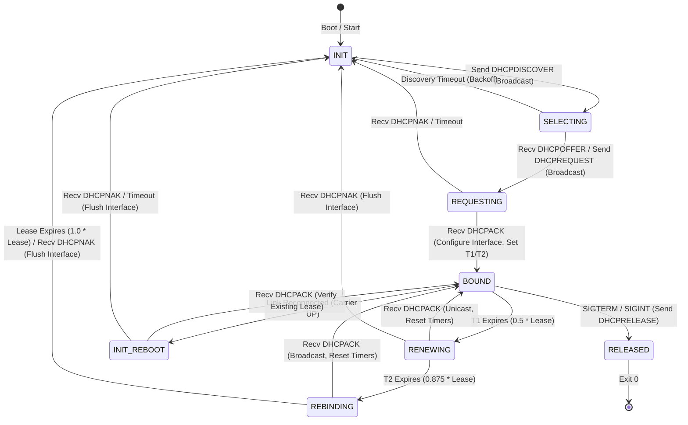

# DHCP v2 Client & Background Renewal Daemon — Architectural Plan

Status: DRAFT / APPROVED FOR IMPLEMENTATION (2026-10-16).  
Addresses: Dynamic IPv4 configuration, automatic boot-time startup, RFC 2131 full lease state machine, non-blocking early boot fallback, background lease renewal ($T_1$/$T_2$), `SYS_NANOSLEEP` zero-CPU sleep, and link flap recovery.

---

## 1. Executive Summary & Problem Statement

### 1.1 Current State (DHCP v1)
FortressOS currently includes DHCP Client v1 (`/sbin/dhcpc`) and Broadcast Probe (`/bin/dhcp-probe`), proven across BIOS/UEFI QEMU and verified on bare-metal Dell Latitude 5590 hardware (`docs/roadmap/dhcp-v1.md`).  
However, v1 has several key architectural limitations:
1. **Manual Invocation Only:** On live media (and default boot), the network defaults to QEMU static IP `10.0.2.15/24` unless the operator manually logs in and runs `sudo /sbin/dhcpc`.
2. **Busy-Wait Polling:** Because v1 was implemented before the Time subsystem, it used bounded tick polling via `SYS_SYSINFO` rather than true blocking sleep.
3. **No Lease Renewal ($T_1$/$T_2$):** Once acquired, the lease is never renewed. When the DHCP server's lease timer expires, other network clients could be assigned the same IP, leading to address collisions.
4. **No Link-State Reaction:** Unplugging and replugging the Ethernet cable does not re-verify or re-acquire the lease (`INIT-REBOOT`).
5. **No Clean Release:** Shutting down or rebooting does not send `DHCPRELEASE`.

### 1.2 DHCP v2 Objectives
With the completion of the Time Subsystem (`SYS_CLOCK_GETTIME` 74, `SYS_NANOSLEEP` 75, `timespec_t`), DHCP v2 delivers:
- **Automatic Boot-Time Startup:** FortressOS automatically triggers DHCP discovery at boot when `net=dhcp` is present on the kernel command line, or by default when no static `net=` parameter is provided.
- **Bounded Non-Blocking Boot:** If no cable is connected or the DHCP server is unresponsive, boot **never hangs**. A bounded initial probe (3 seconds) attempts synchronous configuration before login; if unacknowledged, boot proceeds immediately to `/bin/login`, while the background daemon continues discovery in the background.
- **RFC 2131 State Machine:** Full support for `BOUND`, `RENEWING` (unicast at $T_1 = 0.5 \times \text{lease}$), `REBINDING` (broadcast at $T_2 = 0.875 \times \text{lease}$), and lease expiration ($1.0 \times \text{lease}$) with automatic interface flush.
- **Zero CPU Inactive Sleep:** The background daemon sleeps using `SYS_NANOSLEEP(CLOCK_MONOTONIC)` with 0% CPU consumption during renewal intervals.
- **Link Flap Resilience:** Autonomous detection of carrier drops (`NET_IF_LINK_DOWN`) and recovery via RFC 2131 `INIT-REBOOT` on reconnect (`NET_IF_LINK_UP`).
- **Graceful Shutdown:** Traps `SIGTERM` / `SIGINT` to send `DHCPRELEASE` to the server before unbinding.
- **Strict Ring 3 Userspace:** All logic resides in `/sbin/dhcpc` and `user/dhcp_codec.[ch]`. No kernel-space network hacks; protocol execution conforms strictly to `PROTECTED.md` (BSP network worker ownership).

---

## 2. Invariants & Architectural Contracts

1. **Ring 3 Authority:** DHCP client and renewal logic execute entirely in Ring 3 userspace. All kernel interactions occur via standard system calls (`SYS_SOCKET`, `SYS_BIND`, `SYS_SENDTO`, `SYS_RECVFROM`, `SYS_NETCTL`, `SYS_CLOCK_GETTIME`, `SYS_NANOSLEEP`, `SYS_SPAWN_EXT`, `SYS_SIGACTION`).
2. **BSP Protocol Worker Contract (`PROTECTED.md`):** All socket operations and packet I/O are handled via the registered CPU-0 worker. The DHCP daemon can run on any CPU under the Phase 3 unpinned spawn policy; its socket system calls dispatch safely to CPU 0.
3. **No Terminal Stealing:** The background daemon runs detached (`stdin` redirected from `/dev/null`, `stdout`/`stderr` directed to `/run/dhcpc.log` or closed). It must never interfere with the foreground interactive console owned by `/bin/login` or `/bin/shell`.
4. **Filesystem Boundaries & RAM-Backed Ephemeral State:**
   - Active runtime state lives in `runfs` (`/run` and `/tmp`), which is FortressOS's static in-memory RAM-backed filesystem (equivalent to Linux `tmpfs`).
   - Files `/run/dhcpc.pid`, `/run/dhcpc.lease`, and `/run/dhcpc.log` are strictly ephemeral: they reside in RAM, never touch persistent disk, and are inherently cleared on reboot.
   - Resolver configuration is written to `/tmp/resolv.conf` (and `/run/resolv.conf`).
   - Network configuration is written to `/tmp/network.conf` (live inspection) and, if `/etc/network` is writable, persisted to `/etc/network/network.conf`.
5. **Monotonic Timing:** All timer accounting ($T_1$, $T_2$, lease expiration, retransmit backoff) uses `CLOCK_MONOTONIC` via `SYS_CLOCK_GETTIME` to remain completely immune to RTC / system wall-clock time adjustments.
6. **No-Hang Guarantee:** System boot must never block indefinitely waiting for network responses. Bounded timeouts govern all early boot probes.
7. **Single IPv4 Address Model & Active TCP Reset Constraint:**
   - The kernel networking stack (`src/net/net.c`, `SYS_NETCTL` `NETCTL_IFSET`) implements a single-IP configuration per interface. Dual-IP alias migration (holding old and new IPs simultaneously during draining) is not supported.
   - As long as the leased IP remains unchanged upon renewal, active TCP connections (such as ongoing SSH sessions) continue uninterrupted.
   - If the DHCP server assigns a *different* IP during renewal/rebind (or following lease expiration / NAK recovery), active TCP connections will be reset when `SYS_NETCTL` reconfigures the interface. Clients must reconnect to the new address. The SSH daemon listener, bound to `0.0.0.0`, survives and accepts new connections on the new address immediately.

---

## 3. RFC 2131 State Machine Design



### 3.1 States and Actions

| State | Trigger | Action | Destination | Message Type |
|---|---|---|---|---|
| `INIT` | Startup / Expire / NAK | Allocate transaction ID (`xid`), clear local IP | `255.255.255.255:67` | `DHCPDISCOVER` (Broadcast, `ciaddr = 0.0.0.0`) |
| `SELECTING` | `DHCPOFFER` received | Select offer, record `yiaddr`, `server_id`, parameters | `255.255.255.255:67` | `DHCPREQUEST` (Broadcast, Option 50=`yiaddr`, Option 54=`server_id`, `ciaddr = 0.0.0.0`) |
| `REQUESTING` | `DHCPACK` received | Apply IP/mask/gateway via `SYS_NETCTL`, write `/run/dhcpc.lease`, calculate $T_1$, $T_2$, $T_{\text{expire}}$ | N/A | State `BOUND` |
| `BOUND` | Normal operation | Sleep via `SYS_NANOSLEEP` until $T_1$, link flap, or signal | N/A | Zero CPU consumption |
| `RENEWING` | $T_1$ expired | Unicast request to lease server | `offer.server_ip:67` | `DHCPREQUEST` (Unicast, `flags = 0`, `ciaddr = local_ip`, NO Option 50/54) |
| `REBINDING` | $T_2$ expired | Broadcast request to any server | `255.255.255.255:67` | `DHCPREQUEST` (Broadcast, `flags = 0x8000`, `ciaddr = local_ip`, NO Option 50/54) |
| `INIT-REBOOT` | Link restored | Confirm lease on reconnected network | `255.255.255.255:67` | `DHCPREQUEST` (Broadcast, `flags = 0x8000`, `ciaddr = 0.0.0.0`, Option 50=`last_ip`, NO Option 54) |
| `RELEASE` | Process shutdown (`SIGTERM`/`SIGINT`) | Release IP to server, remove `/run/dhcpc.pid` | `offer.server_ip:67` | `DHCPRELEASE` (`ciaddr = local_ip`, Option 54=`server_id`, Option 61=`MAC`) |

### 3.2 Timer Calculation & Randomized Jitter (RFC 2131 §4.4.5)
- **Lease Time ($L$):** Parsed from Option 51 (`DHCP_OPT_LEASE_TIME`). Default if omitted: 86,400s (24h).
- **Renewal Timer ($T_1$):** Parsed from Option 58 (`DHCP_OPT_RENEWAL_TIME`). If absent, computed as:
  $$T_1 = 0.5 \times L$$
- **Rebind Timer ($T_2$):** Parsed from Option 59 (`DHCP_OPT_REBINDING_TIME`). If absent, computed as:
  $$T_2 = 0.875 \times L$$
- **Randomized Jitter Mitigation (RFC 2131 §4.4.5):**
  To prevent synchronized request bursts (thundering-herd spikes on DHCP servers) across large fleets of clients, random jitter is sampled using `SYS_GETRANDOM`:
  - A random signed offset $\delta \in [-3, +3]\text{ seconds}$ is derived from cryptographic hardware / DRBG entropy.
  - Applied to $T_1$ and $T_2$ upon acquiring or extending a lease:
    $$T_{1,\text{eff}} = \max(1, T_1 + \delta_1)$$
    $$T_{2,\text{eff}} = \max(T_{1,\text{eff}} + 1, \min(L - 1, T_2 + \delta_2))$$
  - Strict ordering invariant maintained under all circumstances:
    $$1 \le T_{1,\text{eff}} < T_{2,\text{eff}} < L$$
- **Monotonic Expiration:**
  $$t_{\text{renew}} = t_{\text{ack}} + T_{1,\text{eff}}, \quad t_{\text{rebind}} = t_{\text{ack}} + T_{2,\text{eff}}, \quad t_{\text{expire}} = t_{\text{ack}} + L$$

---

## 4. Boot-Time Startup Architecture

### 4.1 Kernel Command Line Semantics
FortressOS parses `boot_info.cmdline` during early initialization:
- `net=dhcp`: Explicitly requests dynamic DHCP configuration at boot (default behavior if NIC present and no static configuration given).
- `net=<ip>/<prefix>,<gateway>`: Static IP configuration (e.g. `net=10.0.2.15/24,10.0.2.2`). Bypasses automatic DHCP at boot.
- `net=none` or `net=off`: Disables network hardware configuration at boot.

### 4.2 Early Boot Two-Phase Execution Flow

```mermaid
sequenceDiagram
    autonumber
    participant Kernel as FortressOS Kernel (main.c)
    participant BootClient as /sbin/dhcpc --boot
    participant Daemon as /sbin/dhcpc --daemon
    participant Login as /bin/login (Console Owner)

    Kernel->>Kernel: net_boot_probe() & net_start()
    Note over Kernel: VFS, runfs (/run, /tmp) initialized
    Kernel->>BootClient: process_spawn_initial_vfs_args("/sbin/dhcpc", "--boot")
    
    activate BootClient
    BootClient->>BootClient: Probe eth0 link state (SYS_NETCTL IFGET)
    alt Link UP & DHCP Server Responds (<= 3s)
        BootClient->>BootClient: Handshake complete (DISCOVER->OFFER->REQUEST->ACK)
        BootClient->>BootClient: Apply IP/Gateway (SYS_NETCTL IFSET)
        BootClient->>BootClient: Write /run/dhcpc.lease, /tmp/resolv.conf, /tmp/network.conf
        BootClient->>Kernel: Print: "eth0: DHCP lease acquired 192.168.1.50/24"
    else Link WAITING / Timeout (3s expired)
        BootClient->>Kernel: Print: "eth0: no DHCP response; continuing in background"
    end
    
    BootClient->>Daemon: SYS_SPAWN_EXT("/sbin/dhcpc", "--daemon", detached)
    BootClient->>Kernel: Exit 0
    deactivate BootClient
    
    activate Daemon
    Daemon->>Daemon: Write /run/dhcpc.pid
    Daemon->>Daemon: Enter background event loop (SYS_NANOSLEEP)
    
    Kernel->>Login: process_spawn_initial_vfs("/bin/login")
    Kernel->>Login: input_terminal_bootstrap(login_pid)
    Note over Login: Interactive console ready; user can log in immediately
```

### 4.3 Detailed Startup Mechanics
1. **Synchronous Fast Probe (`/sbin/dhcpc --boot`):**
   - Executed by `main.c` immediately after storage mounting and before the login supervisor loop.
   - Checks if a valid network controller exists (`SYS_NETCTL` `NETCTL_IFGET`). If `EIO` (absent NIC), it exits 0 immediately without printing spurious errors.
   - If link state is `NET_IF_LINK_UP`:
     - Sends `DHCPDISCOVER` and waits up to 3 seconds for `DHCPOFFER`.
     - Completes 4-way handshake, applies address and gateway atomically via `SYS_NETCTL` `NETCTL_IFSET`, updates resolver and config files.
     - Logs one clean line to console: `eth0: DHCP lease 192.168.1.50/24, gateway 192.168.1.1, DNS 192.168.1.1`.
   - If link state is `NET_IF_LINK_WAITING` or timeout occurs:
     - Logs: `eth0: link waiting / no DHCP response; continuing in background`.
2. **Spawning the Background Daemon:**
   - Before exiting, `/sbin/dhcpc --boot` calls `SYS_SPAWN_EXT`:
     - Path: `/sbin/dhcpc`
     - Argv: `["/sbin/dhcpc", "--daemon", NULL]`
     - Flags: `SPAWN_SETPGROUP` (runs in its own process group, detached from terminal signals)
     - FD Actions: `dst_fd = 0` redirected to `/dev/null` (or closed); `dst_fd = 1, 2` redirected to `/run/dhcpc.log`.
   - The boot probe process exits cleanly with status 0.
3. **Interactive Login Hand-off:**
   - The kernel reaps the boot probe process (`sched_reap_dead()`).
   - The kernel spawns `/bin/login`, binds terminal input via `input_terminal_bootstrap()`, and presents the login prompt.
   - If network configuration succeeded during the fast probe, network is already 100% active when the user logs in. If it was delayed, the daemon configures the network in the background as soon as an offer is received.

---

## 5. Background Daemon Architecture (`/sbin/dhcpc --daemon`)

### 5.1 Event Loop and Non-Busy Wait
The daemon avoids continuous polling:
- When in `BOUND` state with remaining time $\Delta t = t_{\text{renew}} - t_{\text{now}}$:
  - If $\Delta t > 10\text{s}$, the daemon sleeps for intervals of up to 10 seconds via `SYS_NANOSLEEP`:
    ```c
    timespec_t req = { .tv_sec = 10, .tv_nsec = 0 };
    sys_call(SYS_NANOSLEEP, (uintptr_t)&req, 0, 0, 0, 0, 0);
    ```
  - Upon waking, it queries link state via `SYS_NETCTL` `NETCTL_IFGET`. If the cable was disconnected, it reacts immediately (see §5.2). If carrier is still up, it repeats until $t_{\text{now}} \ge t_{\text{renew}}$.
  - CPU usage during this quiescent period is strictly 0.00%.

### 5.2 Link-State Reaction & Carrier Recovery
- **Carrier Loss (`NET_IF_LINK_DOWN` / `NET_IF_LINK_WAITING`):**
  - Daemon detects carrier loss during its 10-second tick.
  - Marks state `DISCONNECTED`. Suspends expiration timers.
- **Carrier Restoration (`NET_IF_LINK_UP`):**
  - Transitions to `INIT-REBOOT`.
  - Broadcasts `DHCPREQUEST` adhering strictly to RFC 2131 §4.3.2 wire semantics:
    - `ciaddr = 0.0.0.0` (client is verifying, not using, the IP; MUST NOT be set in BOOTP header).
    - `flags = DHCP_FLAGS_BROADCAST` (0x8000).
    - Option 50 (`DHCP_OPT_REQUESTED_IP`) set to the previously held IP address.
    - Option 54 (`DHCP_OPT_SERVER_ID`) MUST be omitted so any local DHCP server can respond.
    - Sent to `255.255.255.255:67`.
  - If server responds with `DHCPACK`: lease is validated on the network; timers resume; state returns to `BOUND`.
  - If server responds with `DHCPNAK` (e.g. laptop plugged into a different subnet):
    - Flushes interface (`SYS_NETCTL` `NETCTL_IFSET` with `0.0.0.0`).
    - Transitions to `INIT`.
    - Initiates fresh `DHCPDISCOVER`.

### 5.3 Signal Handling
Using `SYS_SIGACTION`:
- `SIGTERM` / `SIGINT`:
  - Graceful termination:
    - Encodes and sends `DHCPRELEASE` to `offer.server_ip`.
    - Removes `/run/dhcpc.pid`.
    - Exits 0.
- `SIGHUP`:
  - Force immediate lease renewal:
    - Sets renewal deadline to current time, waking event loop immediately to enter `RENEWING`.

---

## 6. Shared Codec Extensions (`user/dhcp_codec.[ch]`)

### 6.1 Protocol Constants Added
```c
#define DHCP_OPT_RENEWAL_TIME   58   /* T1 interval in seconds */
#define DHCP_OPT_REBINDING_TIME 59   /* T2 interval in seconds */

#define DHCP_MSG_DECLINE        4
#define DHCP_MSG_RELEASE        7
#define DHCP_MSG_INFORM         8
```

### 6.2 Encoder Signatures
1. `dhcp_encode_discover(...)` (existing):
   - Broadcast `DHCPDISCOVER`, `ciaddr = 0.0.0.0`.
2. `dhcp_encode_request_select(...)` (existing `dhcp_encode_request`):
   - Broadcast `DHCPREQUEST`, `ciaddr = 0.0.0.0`, Option 50 = requested IP, Option 54 = server IP.
3. `dhcp_encode_request_renew(uint8_t *buf, size_t max_len, uint32_t xid, const uint8_t mac[6], uint32_t client_ip, size_t *out_len)`:
   - Unicast `DHCPREQUEST`, `flags = 0`, `ciaddr = client_ip`, NO Option 50, NO Option 54.
4. `dhcp_encode_request_rebind(uint8_t *buf, size_t max_len, uint32_t xid, const uint8_t mac[6], uint32_t client_ip, size_t *out_len)`:
   - Broadcast `DHCPREQUEST`, `flags = DHCP_FLAGS_BROADCAST`, `ciaddr = client_ip`, NO Option 50, NO Option 54.
5. `dhcp_encode_request_reboot(uint8_t *buf, size_t max_len, uint32_t xid, const uint8_t mac[6], uint32_t requested_ip, size_t *out_len)`:
   - Broadcast `DHCPREQUEST`, `flags = DHCP_FLAGS_BROADCAST`, `ciaddr = 0.0.0.0`, Option 50 = requested IP, NO Option 54.
6. `dhcp_encode_release(uint8_t *buf, size_t max_len, uint32_t xid, const uint8_t mac[6], uint32_t client_ip, uint32_t server_ip, size_t *out_len)`:
   - Unicast `DHCPRELEASE`, `ciaddr = client_ip`, Option 54 = server IP, Option 61 = MAC.

### 6.3 State File & Lease Storage
Lease file location: `/run/dhcpc.lease`:
```ini
IP=192.168.1.50
PREFIX=24
NETMASK=255.255.255.0
GATEWAY=192.168.1.1
DNS1=192.168.1.1
DNS2=8.8.8.8
SERVER=192.168.1.1
LEASE_TIME=86400
T1=43200
T2=75600
ACQUIRED_EPOCH=1729104000
EXPIRE_EPOCH=1729190400
```
PID file: `/run/dhcpc.pid` containing the decimal PID of the active daemon.

---

## 7. Command Line Interface Specifications

`/sbin/dhcpc [OPTIONS]`

| Flag | Long Flag | Description |
|---|---|---|
| `-b` | `--boot` | Early boot mode: perform fast initial acquisition (<= 3s timeout), apply configuration, spawn background renewal daemon (`--daemon`), and exit. |
| `-d` | `--daemon` | Run as continuous background daemon handling $T_1$/$T_2$ renewals, rebinds, link-flap recovery, and release on shutdown. |
| `-n` | `--dry-run` | Perform one-shot discovery and display offered network parameters without mutating interface or writing files. |
| `-s` | `--status` | Display current lease information, remaining lease time, renewal deadlines, and daemon PID from `/run/dhcpc.lease`. |
| `-r` | `--renew` | Send `SIGHUP` to running daemon to force immediate lease renewal. |
| `-k` | `--release` | Send `SIGTERM` to running daemon to trigger `DHCPRELEASE`, clear interface, and stop daemon. |
| `-h` | `--help` | Display usage information and exit. |

---

## 8. Staged Implementation & Verification Plan

### Milestone 1: Shared Codec & Host Verification
- **Implementation:**
  - Update `user/dhcp_codec.h` and `user/dhcp_codec.c` with Options 58, 59, `DHCPRELEASE`, `DHCPDECLINE`, and specialized request variants (`renew`, `rebind`, `reboot`).
- **Host Test Suite (`tests/dhcpc_v2_host.c`):**
  - Pure host-compiled C executable under ASan / UBSan.
  - Unit tests verifying:
    1. Option 58/59 parsing and default calculation ($0.5 \times L$ and $0.875 \times L$).
    2. Encoding and verification of Unicast Renewal `DHCPREQUEST` (RFC 2131 rules: `ciaddr` set, Option 50/54 absent).
    3. Encoding and verification of Broadcast Rebind `DHCPREQUEST` (RFC 2131 rules: broadcast flag, `ciaddr` set).
    4. Encoding and verification of `INIT-REBOOT` `DHCPREQUEST` (RFC 2131 wire assertions: `ciaddr` == 0, `flags` == `DHCP_FLAGS_BROADCAST`, Option 50 present matching previous IP, Option 54 strictly omitted).
    5. Encoding and verification of `DHCPRELEASE`.
    6. Randomized jitter derivation ($\delta \in [-3, +3]\text{s}$) ensuring $1 \le T_{1,\text{eff}} < T_{2,\text{eff}} < L$.
    7. Mock RFC 2131 state machine transition engine (full lifecycle step simulation).

### Milestone 2: Background Daemon & Timer Execution
- **Implementation:**
  - Enhance `user/dhcpc.c` to support `--daemon` mode.
  - Implement the monotonic event loop with `SYS_CLOCK_GETTIME(CLOCK_MONOTONIC)` and `SYS_NANOSLEEP`.
  - Wire signal handlers for `SIGTERM` (release) and `SIGHUP` (renew).
  - Implement `/run/dhcpc.lease` and `/run/dhcpc.pid` generation and reading (`--status`, `--renew`, `--release`).

### Milestone 3: Early Boot Integration
- **Implementation:**
  - Add `--boot` mode to `user/dhcpc.c`: bounded probe + detached `SYS_SPAWN_EXT` daemon launch.
  - Update `src/kernel/main.c`:
    - Check cmdline for `net=dhcp` or lack of explicit static `net=`.
    - If enabled and NIC exists, call `process_spawn_initial_vfs_args("/sbin/dhcpc", 2, (const char *[]){"/sbin/dhcpc", "--boot", NULL})`.
    - Reap probe process, then proceed to `/bin/login`.
  - Ensure Live USB and installed root path compatibility.

### Milestone 4: QEMU Multi-Firmware Integration Suite (`make test-dhcpc-v2`)
- **Automated Test Scenarios (BIOS & UEFI):**
  1. **Boot-Time Autoconfiguration:**
     - Boot with `net=dhcp`. Verify system boots directly to login prompt.
     - Verify interface is pre-configured with IP (`10.0.2.15/24`) without manual `dhcpc` run.
     - Verify gateway ping succeeds immediately from login shell.
     - Verify `/run/dhcpc.lease` and `/run/dhcpc.pid` exist and contain valid data.
  2. **Daemon CPU Quiescence:**
     - Run `/bin/time` or `/bin/ps` to verify `/sbin/dhcpc --daemon` is sleeping and consuming 0% CPU.
  3. **Status Query:**
     - Run `/sbin/dhcpc --status` and verify parsed lease output.
  4. **Forced Renewal:**
     - Run `/sbin/dhcpc --renew` (sends `SIGHUP`), verify renewal exchange in pcap / serial output.
  5. **Clean Release:**
     - Run `/sbin/dhcpc --release` (sends `SIGTERM`), verify `DHCPRELEASE` packet emitted and PID file removed.
  6. **Offline Boot Resilience:**
     - Boot with `-net none` or disconnected cable.
     - Verify boot prompt appears within $\le 3$ seconds.
     - Verify no kernel panic, hang, or infinite lock.

### Milestone 5: Bare-Metal Dell Latitude 5590 Acceptance Protocol
- **Physical Verification Steps:**
  1. Flash `bin/fortress.img` to physical USB flash drive.
  2. Boot Dell Latitude 5590 with wired Ethernet cable connected to LAN with DHCP server.
  3. Verify system boots to `FortressOS login:` prompt with announcement `eth0: DHCP lease acquired <ip>/<prefix>`.
  4. Log in as `operator`. Run `ifconfig` to verify IP, gateway, and packet counters.
  5. Run `ping <gateway>` and `nslookup google.com` to confirm network and DNS resolution work out-of-the-box.
  6. Run `/sbin/dhcpc --status` to inspect lease expiration timestamps.
  7. Unplug Ethernet cable for 10 seconds, replug cable. Verify carrier recovery (`INIT-REBOOT`) revalidates lease and connectivity resumes.
  8. Run `sudo /sbin/dhcpc --release` to verify clean release.
