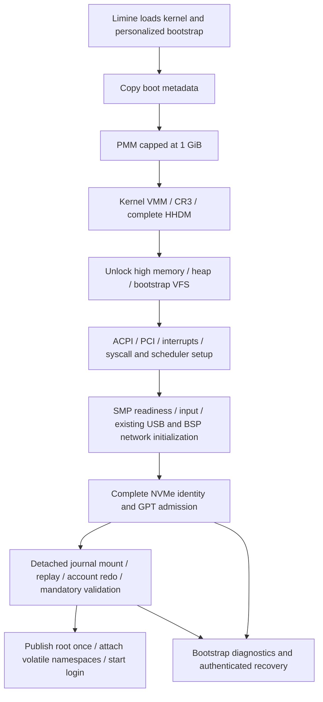

# Persistent Root / NVMe Installer — Phase 0 Contracts

2026-10-10. Design and disposable-fixture work authorized by the user.
Implementation and physical erasure are separate from this checkpoint.
Parent: [milestone plan](PERSISTENT_ROOT_INSTALLER_PLAN.md).

## 1. Decisions and scope

NVMe-only whole-disk installation from live USB. SATA/AHCI and USB installation
are excluded. First physical machine: Dell Latitude 5590. The user will remove
the OS NVMe and replace it with a spare for acceptance. The subsequently
identified SK hynix SC311 SATA 128 GB is **not** an eligible NVMe target; a spare
NVMe is required. The user subsequently reported having another NVMe; its exact
model/serial/geometry remains to be recorded before physical acceptance.
No physical writes are authorized by these decisions.

### Separate live and installer build outputs

Preserve both workflows, as explicitly requested by the user:

- Live image: boots the existing TarFS system without installation. Preserve
  normal make and bin/fortress.iso / bin/fortress.img behavior, including existing
  explicitly selected USB data persistence. No installed-root selection or
  NVMe installer write admission in the normal live entry.
- Installer image: separate make installer-image output, proposed paths
  bin/fortress-installer.iso and bin/fortress-installer.img, carrying the trusted
  partition payloads and installer/bootstrap programs. It offers explicit
  installation and live rescue choices. Merely booting it grants no raw lease
  and performs no destructive write. Installer boot mode makes the control API
  available only after privileged explicit target admission.
- Installed disk: produced by the installer on the confirmed NVMe, personalized
  with account and recovery credentials. A generic build artifact never contains
  an installed recovery credential or a preconfirmed target identity. Root/ESP
  templates are input payloads, not a ready-to-boot personalized installation.

Both artifact families get isolated staging directories, distinct manifests and
clear menu labels. Building installer media must not overwrite or modify the live
image/data partition. Both ISO and raw-USB images remain supported build formats;
USB is boot media, not an installation target. New installer build targets are
specified here for Phase 4; Phase 0 implements only fixture verification tooling.

First supported target has 512-byte logical sectors, one conventional active
namespace, no separate metadata/protection information, and working synchronous
flush. 512-byte logical / 4096-byte physical sectors are acceptable with aligned
partition boundaries; 4096-byte logical sectors are rejected for installer v1.
Unknown geometry, truncated discovery, multiple controllers or multiple active
namespaces reject installer admission in v1. Full multi-controller support is a
later extension, not permission to initialize whichever device appears first.

Use a fixed bounded profile initially: 64 MiB ESP, 256 MiB journaled root,
1 MiB dedicated BIOS stage partition. Minimum whole disk: 324 MiB, with primary
and backup GPT at the actual disk ends. Larger capacity stays unallocated and is
shown before erasure. This is a deliberate first-profile limit, not full-drive
capacity support; expansion needs additional EXT4 geometry/performance evidence.

| GPT slot | Start LBA | Sector count | Type / purpose |
| --- | --- | --- | --- |
| 1 | 4096 | 131072 | ESP / FAT32 |
| 2 | 135168 | 524288 | Linux filesystem / installed root |
| 3 | 2048 | 2048 | BIOS Boot / Limine stage 2 |

Use 128 entries of 128 bytes in both GPT arrays. Validate every range and CRC,
preserve protective MBR bytes when inserting stage 1, and never auto-repair GPT.

## 2. UEFI and BIOS boot

UEFI installs EFI/BOOT/BOOTX64.EFI. No kernel SetVariable, EFI runtime mappings
or efibootmgr dependency is introduced. Fresh-variable OVMF tests establish only
the tested firmware's behavior. UEFI removable-media naming is specified by the
[UEFI boot-manager specification](https://uefi.org/specs/UEFI/2.10/03_Boot_Manager.html);
it is not a universal promise that all internal-disk firmware auto-discovers it.

On 2026-10-10 the user confirmed the Dell 5590 provides F2 "Add Boot Option" with
file selection and F12 boot choices. Supported physical procedure: after spare
NVMe installation, use firmware to add a FortressOS entry selecting the target
ESP's EFI/BOOT/BOOTX64.EFI, then select that entry in F12. Record this required
step in installer completion instructions. It is a firmware operation by the
user, not an undocumented host-side tool. Do not alter the original OS entry.
The menu observation is not yet an installed-disk boot pass.

BIOS uses pinned Limine v8 stage 1 plus stage 2 in GPT slot 3. Audit the local
limine/limine.c bios_install path: passing an explicit partition preserves GPT
entry arrays; the default embedding path rewrites their entry count. Native
installation consumes a host-generated BIOS capsule for these fixed stage
addresses, preserving bytes 440..509 of the target MBR and patching only documented
boot-code fields. Validate against the pinned host utility byte-for-byte. Do not
port an unbounded hosted installer wholesale into the kernel.

## 3. Boot syntax, ordering and root publication

New tokens: boot_mode=live|installed|recovery and root=PARTUUID=<canonical-guid>.
Absence of both preserves existing live boot. Duplicate/unknown/malformed mode,
installed/recovery without root, duplicate root, zero GUID or truncated command
line rejects installed admission. Existing boot_info.cmdline is 512 bytes; add
an explicit truncation indicator rather than parsing a potentially truncated
valid prefix. Recovery mode never bypasses authentication.

Target-specific bootstrap metadata binds installation ID, root PARTUUID,
filesystem UUID, payload version and recovery credential. Config values must
match module metadata. Device identity at installer time binds controller serial,
BDF, NSID, geometry, NGUID/EUI64 when present and discovery generation. At boot,
scan complete eligible inventory read-only and require a unique PARTUUID;
enumeration index and BDF are not persistent root identities.

Preserve existing mandatory init dependencies, including PMM/VMM order, TSS/CR3
ownership and BSP-only network operations. Installer target probing must not run
raw-write self-tests. No installed process runs during detached-root validation.

Separate EXT4 prepare/publication: prepare returns an owned, unexposed mount and
root node; it performs admitted journal replay, activation and orphan recovery.
Validate mandatory directories, install readiness, ELF/metadata, account sets
and pending-account redo against that detached tree. Publication is boot-only,
non-failing after preparation, and changes the active VFS root exactly once.
Audit path construction so a root child is /bin, not //bin. Retain bootstrap tree
and module frames for boot lifetime; no live pivot_root or module reclamation.

Reattach existing devfs/runfs nodes to the published root without duplication or
identity changes. Hide persistent /dev, /run and /tmp contents beneath volatile
mounts; they are placeholders. Runfs already implements /run and /tmp, with a
shared 64-node pool and 4096-byte file limit. Preserve those bounded limits and
sticky-directory enforcement. The first installed system supports one active
EXT4 mount (root); defer simultaneous external EXT4 /mnt mounting because current
e4_active is a singleton. Live USB /mnt behavior remains as implemented.

Before publication, any failure retains bootstrap diagnostics. After publication,
failure to launch login latches installed authentication off and invokes a
bootstrap-backed recovery program through an explicit namespace binding; do not
swap global root back while task/file references exist. Recovery's credential
and executable paths always resolve in bootstrap. Arbitrary shell commands use
the active namespace; root access/writes require authenticated recovery and
explicit admitted policy. A tainted mount cannot be reopened writable in place.

## 4. Executables, login, durability and caller inventory

| Code / callers | Current limitation | Required later change |
| --- | --- | --- |
| main.c initial login loop | raw TarFS node->data/process_spawn | owned VFS bootstrap/root spawn, root credentials and cleanup |
| thread.c process_spawn_from_vfs_group | mutable coherent snapshot required for trusted set-ID | EXT4 exec_snapshot with metadata/bytes under exclusion; pin/copy/free correctly |
| ext4.c and ext4_mount_journal.inc | /mnt-only publication, singleton e4_active | detached prepare and root-only publication; retain live /mnt path |
| ext4_permissions.inc e4_value | always nosuid/nodev; no EXT4 exec_snapshot | per-mount trusted-root flags; external data stays nosuid/nodev |
| vfs.c g_vfs_root / path and permission traversal | synthetic singleton root | boot-only publication, volatile mount routing, owned refs |
| runfs/devfs/tarfs | bootstrap-linked nodes, module-backed files | preserve identity/lifetime; reattach mounts without copying module data |
| boot_info.c module snapshot | first nonempty module only | bounded typed bootstrap/readiness module snapshots and duplicate rejection |
| login.c runtime()/login_main | requires /run/user/<uid>, caches DB before prompts | installed /home/user and root home validation; refresh authentication snapshots |
| userdb_io.c db_load | requires readonly files | snapshot API for installed mutable DB; retain live RO validation |
| sudo.c / whoami.c | loads separate canonical files | coherent snapshot/generation revalidation for privileged authentication |
| syscall.c SYS_SYNC / sys_power; usb_mount.c | USB /mnt-centric routing | installed root sync/freeze dispatch before power action |
| nvme.c / block.c | singleton first PCI device/namespace, no serial/model public identity | complete discovery/rejection, Identify Controller identity, exclusive gate |
| gpt.c registry/reset | boot-only static global parser scratch | owned parse result per admitted disk; no runtime reset of mounted adapters |

Initial bootstrap login must not rely on a current user process for actor
credentials. Define a trusted owned-spawn wrapper around shared image validation
and process publication with explicit root creds and foreground terminal setup.
EXT4 snapshot holds filesystem exclusion while reading bytes and authoritative
metadata into a bounded heap buffer, then loader consumes the copy outside that
lock. Reads must be complete or fail; set-ID decisions and bytes share a snapshot.
No lock across scheduling, process lock nesting or address-space ownership change.

Existing journaled operations commit/checkpoint synchronously, and ext4_sync
drains orphans then performs block_flush, preserving dirty/RECOVER. Thus the
account protocol can use root-wide barriers under an exclusive update lease;
no new fsync is assumed necessary for v1. SYS_SYNC routing must be changed before
using it. Failed barrier taints and never reports success. Shutdown freezes root,
drains and marks clean before controller quiescence; it must not quiesce a device
while filesystem work remains.

## 5. Recovery provisioning and bounded personalization

User chooses and confirms a separate 12..128-byte printable ASCII recovery
passphrase (0x20..0x7e), with no echo. Reject overflow after draining the whole
line, mismatch, empty/short input and unsupported bytes. No skip/fallback. Obtain
the normal operator password independently; root login remains locked and sudo
uses the operator password. All credential/target validation precedes destructive
write admission. Wipe secret buffers on retry, cancellation, success and error.

Recovery hash uses existing $5$ SHA-256-crypt with rounds=100000 (existing parser
ceiling) and a fresh 16-character crypt-alphabet salt. Factor hash generation
from userdb.c verification and verify independent Linux vectors. Recovery prompt
delays failed attempts for at least two BSP-monotonic seconds, not input-wait
iterations. Recovery-secret rotation remains outside v1.

Before raw admission, build an owned personalized USTAR bootstrap in memory:
strictly validate the supplied archive, reject links/devices/duplicate paths,
copy trusted entries, append bootstrap directory and bootstrap/recovery.v1,
then full two-block termination. Module <=8 MiB; record <=512 bytes, root-owned
0600; bootstrap directory 0700. Record format: version, install ID, root PARTUUID,
filesystem UUID and crypt hash with exact bounded fields. No plaintext secret.
This record is not an installed passwd/shadow file. Shared media has no record.
Use ASCII lines in fixed order: FORTRESS-RECOVERY-1, install_id=<32 lowercase hex>,
root_partuuid=<36-character GUID>, filesystem_uuid=<36-character GUID>, and
password_hash=<$5$rounds=100000$...>. Each line ends LF, no CR/NUL/extra fields;
reject absent, duplicated, reordered or oversized fields before authentication.

Installer edits only preallocated files in a fixed FAT32 ESP template: fixed
short-name boot paths, 8 MiB contiguous bootstrap slot, 4 KiB config slot and
512-byte readiness slot. Validate BPB, both FAT copies, cluster chains, directory
entries and all physical ranges against the payload manifest before edits.
Patch file sizes and fill unused slot bytes with zero; no generic FAT allocator
or kernel FAT mount is required. Verify personalized bytes and FAT consistency
using independent mtools/fsck.fat on fixture copies in Phase 4.

Fresh salt/GUID source: bounded RDSEED attempts (64 per word), then bounded
RDRAND attempts if advertised by CPUID. Installation rejects if neither succeeds;
no TSC/MAC/network entropy fallback. Add a privileged bounded seed service for
installer use (max 256 bytes/call); normal boot need not require RNG. GUIDs use
128 seed bits with UUID version/variant bits and collisions checked against
attached inventory and each generated ID. Filesystem UUID stays template-specific
in v1 because changing it requires rewriting metadata and journal checksums;
never select root by filesystem UUID. Pair PARTUUID and install ID and reject
duplicate installed identities. Independently confirm the physical CPU RNG
capability before installer acceptance.

## 6. Installer control ABI and exclusive ownership

Design reservations only: SYS_INSTALLCTL=71, SYS_ACCOUNTCTL=72, SYS_INSTALLSEED=73
(unused at this checkpoint; recheck allocation before defining public headers).
INSTALLCTL(op, input, input_bytes, output, output_bytes) is versioned by explicit
size/version fields; reserved fields must be zero. Copy and validate all user
ranges before any device operation. No raw write through ordinary /dev nodes.

| Operation | Input / output | Effect |
| --- | --- | --- |
| ENUM=0 | uint32 index / identity_v1, 192 bytes | read-only complete inventory, 1 entry / 0 end |
| ACQUIRE=1 | target_v1, 64 bytes / int32 lease fd | explicit identity-bound whole-device lease |
| READ=2, WRITE=3 | io_v1, 40 bytes / none | exact bounded sector run; return 0 or error |
| FLUSH=4 | int32 lease fd / none | synchronous barrier; 0 only on success |
| RELEASE=5 | int32 lease fd / none | consumes lease; does not imply successful install |

identity_v1 offsets: size/version 0/4, generation u64 8, sector_count u64 16,
sector_size u32 24, nsid u32 28, segment u16 32, bus/device/function/flags u8
34/35/36/37, zero u16 38, serial[20] 40, model[40] 60, zero[4] 100,
nguid[16] 104, eui64[8] 120, identity SHA-256[32] 128, zero[32] 160.
Text fields are fixed byte arrays with explicit sanitization for display, not
implicitly NUL-terminated strings. Digest covers the canonical identity fields.
target_v1: size/version 0/4, generation u64 8, index/flags u32 16/20,
identity digest[32] 24, zero[8] 56. Only confirmed-whole-disk flag=1 is accepted.
io_v1: size/version 0/4, lease fd i32 8, zero u32 12, lba u64 16,
sector_count u32 24, zero u32 28, user buffer u64 32. Maximum 8 sectors/4096
bytes per call initially, matching the NVMe bounce buffer. Count/range arithmetic
uses subtraction-based overflow checks. Failure can leave a written prefix;
no retry through sector fallback and no byte-count success after uncertain I/O.

ACQUIRE requires installer boot mode, euid=0, CAP_SYS_ADMIN and CAP_SYS_RAWIO,
an idle non-source/non-root target, unique complete identity, eligible geometry
and successful flush preflight. Request confirmation is not a security boundary
against privileged hostile code; it binds the UI's reviewed selection.
One lease per process/device; final release/exit invalidates it. CLOEXEC,
non-duplicable, non-inheritable, no spawn action mapping, PID/generation bound.
Filesystem mounting and raw lease ownership are mutually exclusive. Later install
provisioning uses a controlled handoff after raw release, not a concurrent mount.
Fatal/disconnect/identity change invalidates lease and retains DMA quarantine.
Privilege/error order: request shape -> credentials/mode -> copied ranges ->
identity/ownership -> geometry -> hardware. Bad requests dispatch no writes.

For live v1, discover every NVMe PCI controller before initializing a target;
reject more than one. Query complete active namespace inventory; reject anything
except one identified namespace, with no NSID=1 fallback for installer admission.
This explicitly requires physically replacing the original OS NVMe for first
physical acceptance. Multiple-disk tests prove zero-write rejection, not a
nonexistent multi-controller install implementation.

## 7. Account publication state machine

Bounds: 16 records per database, 8192 bytes/file, 512 bytes/line, 32-byte name
storage, existing 128-byte home/shell storage and 16 supplementary groups.
Transaction staging at /var/lib/fortress/accounts, root:root 0700, one transaction
at a time. Three immutable new files, three disposable publishing files, a
<=512-byte fixed intent with generation, lengths and SHA-256s; no record paths.
Keep 256 KiB free-space headroom as an admission requirement; it cannot guarantee
future space availability. ENOSPC after intent requires redo/recovery, not rollback.

ACCOUNTCTL uses a kernel-managed per-root reader/writer lease: read snapshot,
begin update, generation check, finish update and bootstrap-only recover state.
ACCOUNTCTL(op, request, request_bytes) uses a 64-byte v1 request: size/version u32
0/4, generation u64 8, lease token u64 16, passwd/group/shadow buffer addresses
u64 24/32/40, lengths/capacities u32 48/52/56, flags u32 60. The user struct is
copied in and updated on success; buffers are not retained. SNAPSHOT=0 returns
generation and lengths, copies the two public databases and (flag 1) shadow only
for euid=0 with CAP_DAC_READ_SEARCH. Each input capacity must be 8192; absent shadow
requires zero address/capacity. BEGIN=1 requires euid=0 and CAP_SYS_ADMIN, no buffer
addresses, no flags; returns process-owned writer token. CHECK=2 has only a
generation, returns 0 if current and authentication enabled, EAGAIN otherwise.
FINISH=3 requires the token, verifies canonical coherence/pending absence and root
barrier before releasing the writer; it never trusts a user success assertion.
RECOVER=4 is restricted to trusted bootstrap operation before login or while
authentication is latched off. Update calls reject stale/mismatched token/PID.
Token exhaustion fails closed; close/exit follows the writer-death contract.
v1 copies bounded snapshots rather than returning descriptors spanning generations.
Authentication snapshots capture a generation and release the reader lease
before waiting for password input. After verification, login/sudo revalidate the
generation before applying privilege decisions; changed generation retries with
a fresh snapshot. Never hold a reader lease indefinitely while a user types.
Successful CHECK is the authentication decision's linearization point: subsequent
database changes do not revoke an already accepted session. Apply only the
credentials from that checked snapshot, never re-read selected fields afterward.
whoami uses the same coherent snapshot without shadow. The writer lease is
process-owned and auto-cancelled before intent; after intent, death latches
authentication off until restartable redo succeeds. No spinlock held across I/O.

| Durable state / interruption | Required restart behavior |
| --- | --- |
| No pending intent; partial staging | canonical old set unchanged; discard staging |
| Complete staging synced; temporary intent only | old set; discard uncommitted staging |
| Pending intent rename committed, even if later sync failed | validate immutable staging and redo new set |
| Any canonical unlink/copy/rename prefix | pending intent retained; redo all three idempotently |
| New canonical set verified and synced; pending removal uncertain | either redo same new set or accept already durable new set |
| Pending removal durable; staging cleanup prefix | accept new set, reclaim staging |
| Invalid intent/staging or uncertain device I/O | block authentication; authenticated recovery |

Canonical publication: construct a complete temporary file from staging with
final mode/owner, close and sync, unlink old name, rename temporary into absent
canonical name, sync; repeat passwd/group/shadow. Immutable staging remains
until pending removal is durable. Never unlink staging before that barrier.
If a crash occurs after temporary intent rename but before its barrier, replay
may expose pending intent: redo is safe because staging was already durable.
The old-set guarantee applies only while durable pending intent is absent, not
to whether the initiating process observed a successful barrier return.
No POSIX atomic-replacement or arbitrary privileged-reader consistency claim.

Proof obligations for Phase 3: hostile intent validation, every filesystem
write/flush cut, journal replay cuts, writer death, stale authentication snapshot,
concurrent writer denial and exact mode/byte oracles. The table is a protocol
proof under admitted filesystem durability, not an actual-code execution pass.

## 8. Payload, install completion and bounded work

Trusted local payload manifest <=16 KiB, strict version and fixed known partition
roles, sector geometry, exact lengths, SHA-256 per partition/capsule, USTAR entry
count <=512, paths <256 bytes, components <64 bytes. Reject special/link types,
unknown fields, duplicates, truncated input and arithmetic overflow. Copy buffers
<=16 KiB; per-I/O NVMe bound remains 4096 bytes. ELF bytes bounded by existing
MAX_ELF_FILE_SIZE and MAX_ELF_PAGES; node cache 1024 and journal transaction credit
limits remain unchanged. New discovery cap: at most four controller descriptors
for diagnostics; any truncation rejects, and v1 accepts exactly one.

The existing driver has iteration-bounded hardware waits. Before physical writes,
specify and implement a monotonic per-command timeout policy (10 seconds for v1
I/O, controller transition deadline from CAP.TO with a documented finite cap).
Keep polling/IRQ discipline; no unbounded retries or scheduler changes hidden in
the installer. Benchmark fixture startup and mount scan before capacity rollout.

Installation commits readiness across ESP and root without pretending they share
a journal. Before payload writes, invalidate existing target boot/readiness
metadata and flush. Deploy root/ESP/BIOS images, personalize bootstrap/config,
provision operator account, audit root, freeze/flush, then write ESP readiness
record last and flush/read back. The readiness record binds install ID, PARTUUID,
payload version, kernel/bootstrap hashes and its own checksum. Its 512-byte
preallocated file is loaded by Limine as a separate module, so bootstrap checks
it before root writes. Personalized bootstrap can be valid while readiness is
absent; that case permits authenticated diagnostics, never normal login.

If torn record/config/archive is invalid or missing, fail closed. Require matching
root install ID after admitted recovery, and validate only immutable installation
identity at normal boot; do not compare mutable root/account files to original
payload hashes. Recovery of a partially installed disk with unusable boot artifacts
uses external live USB. Invalidated/partial installation cannot always boot its
own recovery environment. Reporting success requires verified boot files plus
all barriers; physical independent boot remains an additional acceptance gate.
Snapshot at most two installed modules: the bootstrap USTAR and the exact
512-byte readiness record, identified by validated path basenames and explicit
role metadata. Reject unknown or duplicate modules in installed mode. Current
boot_info_init selects only the first module; extending it is a Phase 1/2
dependency with backing retained under the existing module lifetime contract.

## 9. Phase 0 verification boundaries

scripts/test_root_phase0.py creates fresh regular files below build/root-phase0,
with strict payload extraction, exact Linux format masks, explicit inode metadata,
empty CSUM_V3/revoke journal, Linux fsck and byte/mode audits, target-end GPT and
ESP archive round trip. BIOS/UEFI smoke attaches only a disposable NVMe image,
no installer/source disk, and fresh OVMF vars. It boots the current kernel and
parses TarFS from that ESP, stopping before the legacy 32 MiB QEMU storage suite;
it does **not** implement or prove installed-root boot,
recovery authentication, native installer, account redo or physical durability.
Fixture account entries are locked; ephemeral test secrets exist only in process
memory. Random fixture inputs model two user choices, not installer-generated
production passphrases. Production kernel/mount/write gates are unchanged.

Record executed results and retained failures in
[Phase 0 evidence](../roadmap/persistent-root-phase0.md). Future phases must
implement the dependencies above and pass their own actual-code gates. Physical
NVMe boot/flush/RNG acceptance remains pending on an eligible spare.
