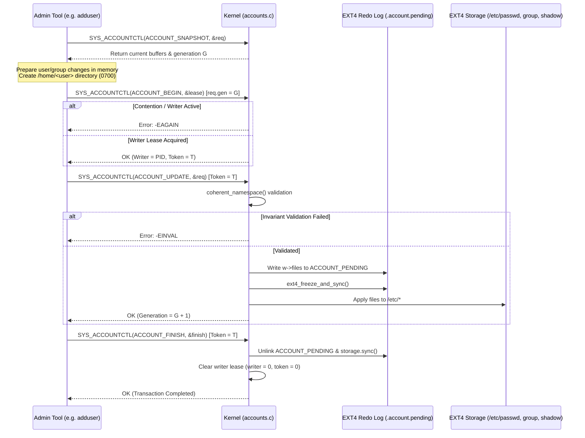
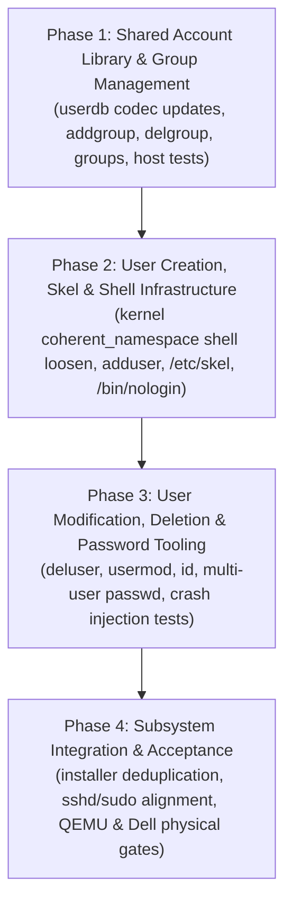

# FortressOS — Users, Groups, and Privileges Subsystem Plan

## 1. Executive Summary & Architecture Overview

FortressOS currently operates with a fixed identity model: an unalterable `root` superuser (UID 0) with a locked shadow entry, and a single auto-created administrative user (`fortress` on live media, or `operator` configured during installation) belonging to the `wheel` group (GID 10). While the underlying kernel provides cryptographic credential structures (`creds_t`), capability masks (`CAP_*`), and atomic multi-file transactional redo logging (`SYS_ACCOUNTCTL`), runtime administrative tools to manage users and groups do not exist.

This design document defines a complete, robust, and crash-safe **Users, Groups, and Privileges Subsystem** for FortressOS. It introduces standard administrative CLI utilities (`adduser`, `deluser`, `addgroup`, `delgroup`, `usermod`, `passwd`, `id`, `groups`) while strictly preserving existing architectural contracts:
- **Crash-Safe Multi-File Transactions**: All mutations to `/etc/passwd`, `/etc/group`, and `/etc/shadow` are coordinated via the kernel's redo-logged `SYS_ACCOUNTCTL` lease protocol (`ACCOUNT_BEGIN` $\rightarrow$ `ACCOUNT_UPDATE` $\rightarrow$ `ACCOUNT_FINISH`).
- **Fail-Closed Privilege Model**: Interactive root login is prohibited (`/bin/nologin` shell and locked shadow hash `!`). Administrative authority is exercised exclusively via `sudo` by members of the `wheel` group.
- **Bounded Resources**: In keeping with FortressOS freestanding principles, all parsing, hashing, file generation, and directory recursion adhere to strict compile-time size, stack, and time bounds with zero unbounded dynamic memory allocation.

```
+---------------------------------------------------------------------------------------------------+
|                                FORTRESSOS USER & GROUP SUBSYSTEM                                  |
+---------------------------------------------------------------------------------------------------+
| Ring 3 Administrative Tools                                                                       |
|   /sbin/adduser    /sbin/deluser    /sbin/addgroup    /sbin/delgroup    /sbin/usermod             |
|   /bin/passwd      /bin/id          /bin/groups       /bin/nologin                                |
+---------------------------------------------------------------------------------------------------+
| Core Account Tool Library (user/tools/account_tool.h, userdb.h, userdb.c)                         |
|   - In-memory database codec (passwd, group, shadow) with strict field validation                 |
|   - Deterministic UID/GID allocation (User Private Group scheme, UIDs/GIDs >= 1000)               |
|   - SHA-256-crypt ($5$) bounded hashing (100,000 rounds, 16-char salt from SYS_INSTALLSEED)      |
|   - Bounded /etc/skel recursive template instantiation (<= 32 files, <= 1 MiB)                   |
+---------------------------------------------------------------------------------------------------+
| Kernel System Call Interface (SYS_ACCOUNTCTL 72)                                                  |
|   - ACCOUNT_SNAPSHOT: Safe atomic multi-buffer read of current database                           |
|   - ACCOUNT_BEGIN: Exclusive single-writer process lease (EAGAIN on contention)                   |
|   - ACCOUNT_UPDATE: Full atomic snapshot commit via redo log (ACCOUNT_PENDING)                    |
|   - ACCOUNT_FINISH: Redo journal commit, disk fsync, and writer lease release                    |
|   - Invariant validator (coherent_namespace): enforces root lock, home dir 0700 & shell validity |
+---------------------------------------------------------------------------------------------------+
| Storage Layer: EXT4 Root Filesystem (Installed) / ETCFS (Live Media)                             |
|   /etc/passwd (mode 0644)       /etc/group (mode 0644)       /etc/shadow (mode 0600)              |
+---------------------------------------------------------------------------------------------------+
```

---

## 2. On-Disk Schema Analysis & Existing Constraints

FortressOS stores account records in standard colon-delimited ASCII flat files backed by the EXT4 root filesystem (or ETCFS in live media). The format adheres to POSIX/Unix conventions, parsed by `user/tools/userdb.c` and validated by the kernel in `src/kernel/accounts.c`.

### 2.1 File Formats and Delimiters

#### 1. `/etc/passwd` (Mode `0644`, Owner `root:root`)
- **Format**: `username:password:uid:gid:gecos:home:shell\n`
- **Fields (7 total, delimited by `:`)**:
  1. `username`: 1..31 characters, alphanumeric plus `_` and `-`. Must start with `[a-z_]`.
  2. `password`: Must be literal character `"x"`, indicating credentials reside in `/etc/shadow`.
  3. `uid`: Unsigned decimal integer (0..4294967295).
  4. `gid`: Unsigned decimal integer (0..4294967295), referencing the user's primary group.
  5. `gecos`: Informational string storing the user's full name (`First Last`). May be empty. Colons prohibited. Maximum 63 characters. Parsed and exposed in `db_user_t.gecos` for CLI tools and future system UI (display managers, settings, profile badges).
  6. `home`: Canonical absolute directory path (`< 128` chars). No relative components (`.` or `..`).
  7. `shell`: Canonical absolute executable path (`< 128` chars). Must be an authorized login shell.

#### 2. `/etc/group` (Mode `0644`, Owner `root:root`)
- **Format**: `groupname:password:gid:members\n`
- **Fields (4 total, delimited by `:`)**:
  1. `groupname`: 1..31 characters, alphanumeric plus `_` and `-`. Must start with `[a-z_]`.
  2. `password`: Must be literal character `"x"` or empty (group passwords unsupported).
  3. `gid`: Unsigned decimal integer (0..4294967295).
  4. `members`: Comma-separated list of usernames belonging to this group. May be empty. Max total field length: 255 characters.

#### 3. `/etc/shadow` (Mode `0600`, Owner `root:root`)
- **Format**: `username:hash:lastchanged:min:max:warn:inact:expire:flag\n`
- **Fields (9 total, delimited by `:`)**:
  1. `username`: Matches username in `/etc/passwd`.
  2. `hash`: Password hash string (`$5$...`), or lock indicator (`!` or `*`), or empty string (passwordless). Max length 95 characters.
  3. `lastchanged`: Days since epoch (1970-01-01) of last password change, or empty/`-1`.
  4. `min`: Minimum days required between password changes, or empty/`-1`.
  5. `max`: Maximum days password remains valid, or empty/`-1`.
  6. `warn`: Days of advance warning before password expiration, or empty/`-1`.
  7. `inact`: Inactivity days before account is locked, or empty/`-1`.
  8. `expire`: Absolute expiration day since epoch, or empty/`-1`.
  9. `flag`: Reserved field, must be empty.

> [!IMPORTANT]
> **Calendar Clock Fail-Closed Policy**: FortressOS does not assume a trusted RTC battery clock at boot. Per `userdb.c:73-76`, if any aging/expiration field is populated with a value other than `""` or `"-1"`, or if `min == "0"`, the parser marks the shadow entry as `restricted = true`. Restricted accounts fail authentication unconditionally.

### 2.2 Password Hash Format ($5$ vs $6$)

FortressOS **exclusively supports $5$ (SHA-256-crypt)** with Ulrich Drepper's specification:
- **Encoding**: `$5$rounds=100000$<16-char-salt>$<43-char-checksum>`
- **Length**: Exactly 77 ASCII characters (78 bytes with terminating NUL).
- **Rounds**: Bounded between 1,000 and 100,000 (`DB_ROUNDS_MAX 100000u`). Default generated rounds: 100,000.
- **Salt**: 16 characters drawn from the standard crypt alphabet (`./0-9A-Za-z`), generated via hardware entropy (`SYS_INSTALLSEED` / `SYS_GETRANDOM`).
- **Rejection of $6$ (SHA-512)**: SHA-512 hashes (`$6$`) are **explicitly rejected** by `userdb.c:118` and verified by `scripts/test_user_database_host.py:25-28`. FortressOS standardizes on a hardened internal SHA-256 core across kernel, packaging, and userland. This eliminates unbounded hashing routines, bounds CPU verification time on low-power hardware, and fits within strict Gate G1 stack budgets.

### 2.3 Limits & Capacity Constraints

| Parameter | Header Macro | Current Value | Subsystem Specification |
| :--- | :--- | :--- | :--- |
| Max Account Records | `DB_MAX_RECORDS` | 16 | Fixed array size in `userdb_t` (`users[16]`, `groups[16]`, `shadows[16]`). Expandable to 32 or 64 if needed; 16 accounts is the current architectural floor. |
| Max File Buffer Size | `DB_FILE_MAX` / `ACCOUNT_FILE_MAX` | 8,192 bytes | Max byte size of `/etc/passwd`, `/etc/group`, or `/etc/shadow`. |
| Max Line Length | `DB_LINE_MAX` | 512 bytes | Max length of any single entry line including newline. |
| Max Username Length | `DB_NAME_MAX` | 32 bytes | 31 printable characters + NUL terminator. |
| Max Group Name Length | `DB_NAME_MAX` | 32 bytes | 31 printable characters + NUL terminator. |
| Max GECOS / Full Name Length | `DB_GECOS_MAX` | 64 bytes | 63 printable characters (`"First Last"`) + NUL terminator. Stored in `db_user_t.gecos` for CLI and future graphical UI. |
| Max Group Members Field | `members` in `db_group_t` | 256 bytes | 255 printable characters + NUL terminator. |
| Max Password Input | `DB_PASSWORD_MAX` | 128 bytes | Interactive password entry ceiling. |
| Max User Supplementary Groups | `CREDS_MAX_GROUPS` | 16 | Number of supplementary GIDs supported by kernel `creds_t`. |

### 2.4 Reserved UID and GID Ranges

```
+--------------------+---------------------------------------------------------------+
| ID Range           | Allocation Category & Usage Contract                          |
+--------------------+---------------------------------------------------------------+
| UID / GID 0        | root: Superuser identity. Locked shadow hash. Login disabled.  |
| UID / GID 1–999    | Reserved System Identities:                                   |
|                    |   GID 5: tty      (terminal devices in /dev)                  |
|                    |   GID 6: disk     (raw block device access)                   |
|                    |   GID 10: wheel   (administrative privilege / sudo)           |
|                    |   GID 44: video   (framebuffer & GPU device access)           |
|                    |   GID 104: input  (keyboard & mouse event input)              |
|                    |   UID/GID 100–999: System daemons (e.g., _sshd, _dhcp)        |
| UID / GID 1000+    | Interactive Users & User Private Groups (UPG):                |
|                    |   1000: Initial user (fortress or operator)                   |
|                    |   1001+: Dynamically allocated by adduser / addgroup          |
+--------------------+---------------------------------------------------------------+
```

---

## 3. Kernel Privilege Model & Administrator Contract

FortressOS implements a dual-layer access control model: POSIX DAC (UID, GID, supplementary groups, permission bits) combined with fine-grained POSIX Capabilities (`creds_t.cap_effective`).

### 3.1 Kernel Credential Structure (`creds_t`)

Defined in [`src/include/creds.h`](file:///c:/Sources/FortressOS/src/include/creds.h):
```c
typedef struct creds {
    uint32_t uid, euid, suid;
    uint32_t gid, egid, sgid;
    uint32_t groups[CREDS_MAX_GROUPS];
    uint16_t ngroups, umask;
    uint32_t reserved;
    uint64_t cap_effective;
} creds_t;
_Static_assert(sizeof(creds_t) == 104, "credential value size");
```
- Credential snapshots are copied **by value** into kernel thread stacks under `g_process_lock`, decoupling lifetime from process death.
- Capability transitions are strictly monotonic downwards: `creds_capset` can clear bits but cannot regain dropped capabilities.
- When an executable image is spawned, the child inherits the parent's effective capabilities and credentials. Setuid binaries (`04755`) evaluate `SYS_SETRESUID` and `SYS_SETRESGID` transitions under strict kernel validation (`CAP_SETUID` / `CAP_SETGID`).

### 3.2 Wheel Group (GID 10) & Sudo Gating

In FortressOS, `wheel` membership is the sole criterion for administrative delegation:
1. **Verification Routine**: `sudo.c:7-15` executes `wheel(const db_user_t *u)`. It locates the group named `wheel` in `database.groups`, resolves the caller's supplementary groups via `db_groups()`, and verifies `wheel->gid` is present.
2. **Fail-Closed Guarantees**:
   - If `/etc/passwd`, `/etc/group`, or `/etc/shadow` fails to load (`!db_load()`), or if the kernel database is busy beyond the retry window, `sudo` terminates with `privileged installation required`.
   - If `u` is not found, or `root` is missing, or `uid != 0` and `!wheel(u)`, `sudo` exits immediately with `user is not authorized`.
   - If `shadow->restricted` is true or the user's password hash is locked (`!`), authorization fails immediately.
   - If `db_check()` indicates another process modified the account database during execution, `sudo` aborts with `accounts changed; retry command`.
3. **The Administrator Contract**:
   Membership in `wheel` grants the right to invoke any command as `root` via `sudo`. It does **not** grant ambient root privileges to ordinary shell processes.

### 3.3 Root Account Policy: No Interactive Root Login

> [!CAUTION]
> **Architectural Decision**: The `root` account **must never log in interactively** on FortressOS.
> - **Shadow Lock**: The `root` entry in `/etc/shadow` is permanently pinned to `root:!:::::::`.
> - **Shell Restriction**: The `root` entry in `/etc/passwd` specifies `/bin/nologin` (or `/bin/shell` with locked password rejection).
> - **SSHD Contract**: Remote root login is strictly refused on wire (`PermitRootLogin no` enforced in `sshd_config.c:235` and `monitor.c:469`).
> - **Console Login Contract**: Console `login` explicitly rejects UID 0 (`login.c:80: u->uid != 0`).
> - **Su Contract**: Direct `su` to root without an authorized password fails because root's shadow hash begins with `!`.
> 
> All system administration is performed through `sudo <command>` or `sudo -s` by authenticated users belonging to `wheel`.

---

## 4. Subsystem Transactions, Atomicity & Crash Safety

The account database must remain 100% consistent across crashes, power failures, and competing processes. FortressOS guarantees this via the kernel's redo-logged `SYS_ACCOUNTCTL` (syscall 72) engine in `src/kernel/accounts.c`.

### 4.1 Transaction Lifecycle (`SYS_ACCOUNTCTL`)



### 4.2 Kernel Invariant Validation (`coherent_namespace`)

Before any update is committed, `src/kernel/accounts.c:coherent_namespace` validates the candidate database in memory:
1. `db_validate(&db)`: Parsable formats, equal user/shadow counts, all primary GIDs exist in `/etc/group`, all group members exist in `/etc/passwd`.
2. `root` invariant: UID 0, name `"root"`, GID 0, home `"/root"`, shadow hash starts with `'!'` or `'*'`.
3. Valid Shell Invariant: Each user's shell must be an authorized shell.
   > [!IMPORTANT]
   > *Kernel Update Requirement*: Currently, `accounts.c:29` requires `strcmp(u->shell, "/bin/shell") == 0`. This must be updated to allow `/bin/nologin` (for root and locked service accounts):
   > `(!strcmp(u->shell, "/bin/shell") || !strcmp(u->shell, "/bin/nologin"))`.
4. Home Directory Invariant: For all non-root users (`u->uid >= 1000`):
   - Path must be `/home/<name>`.
   - The directory **must already exist on disk** as a directory (`VFS_DIRECTORY`), owned by `u->uid:u->gid`, with mode `0700`.

### 4.3 Crash & Interruption Recovery Analysis

| Failure Scenario | State on Interruption | Recovery Mechanism on Reboot / Next Invocation |
| :--- | :--- | :--- |
| **`adduser` killed before `ACCOUNT_BEGIN`** | No changes to disk or database. | Clean state. No recovery needed. |
| **`adduser` killed after creating `/home/<name>` but before `ACCOUNT_UPDATE`** | `/home/<name>` exists on disk (0700). Database files are unmodified. User does not exist in `/etc/passwd`. | Home directory is orphaned. `e2fsck` reports 0 errors. Subsequent `adduser <name>` detects orphaned directory and prompts to reuse or remove it. |
| **`adduser` / kernel crashes during `ACCOUNT_UPDATE`** | Redo journal `ACCOUNT_PENDING` contains candidate files. | On boot, `accounts_prepare()` invokes `account_redo_recover()`. If the redo journal is valid and verified by `coherent_namespace`, it re-applies changes and completes the commit. Otherwise, it rolls back cleanly. |
| **Process holding writer lease crashes** | Writer lease remains tagged with dead PID. | `accounts_process_exit(pid)` detects thread termination and sets `writer_dead`. Next `enter()` call invokes `retire_dead()`, clearing the token and restoring write admission. |
| **`deluser` killed after `ACCOUNT_UPDATE` but before removing `/home/<name>`** | User removed from `/etc/passwd`, `/etc/group`, `/etc/shadow`. `/home/<name>` remains on disk. | User cannot log in (credentials nonexistent). Directory is orphaned. Filesystem is clean. Running `deluser --remove-home <name>` or manual `rm -rf` cleans up. |
| **`delgroup` killed during `ACCOUNT_UPDATE`** | Handled completely atomically by kernel redo journal. Either group is removed or unchanged. | Redo journal commits or rolls back. No partial writes. |

---

## 5. Home Directory & Skeleton Management (`/etc/skel`)

### 5.1 `/etc/skel` Specifications

FortressOS provisions standard skeleton configuration files located at `/etc/skel/`:
- `/etc/skel/.profile`: Default login environment:
  ```sh
  export PATH=/bin:/sbin
  export TERM=fortress
  export HOME=/home/$USER
  ```
- `/etc/skel/.shellrc`: Interactive shell aliases and prompt configuration:
  ```sh
  alias ll='ls -l'
  alias la='ls -la'
  ```

### 5.2 Creation Rules (`adduser`)

When `adduser` provisions `/home/<username>`:
1. Directory Creation: `tool_syscall(SYS_MKDIR, "/home/<name>", 0700)` followed by `SYS_CHOWN(uid, gid)`.
2. Bounded Recursion:
   - Max file count: 32 files.
   - Max aggregate file size: 1 MiB (1,048,576 bytes).
   - Max path depth: 4 subdirectory levels.
3. Permission Enforcement:
   - Copied regular files: mode `0600` (or matching source permissions masked by `0700`), owned by `uid:gid`.
   - Copied directories: mode `0700`, owned by `uid:gid`.
4. Fail-Closed Rollback:
   If disk quota is exceeded, I/O error occurs, or copy fails:
   - Recursively remove all created files in `/home/<name>`.
   - Remove `/home/<name>`.
   - Abort transaction before `ACCOUNT_UPDATE`. Never leave a half-provisioned home directory.

### 5.3 Deletion Rules (`deluser --remove-home`)

When `deluser --remove-home <name>` runs:
1. Safety Boundary Check:
   - Target path must strictly equal `/home/<name>`. Paths containing `..`, symlinks, or pointing to `/`, `/root`, `/bin`, `/etc` are rejected.
2. Ownership Audit:
   - Recursively inspect files within `/home/<name>`. If any file is owned by another UID (e.g., UID 0), deletion aborts unless explicitly forced, preventing unauthorized destruction of shared data.
3. Bounded Removal:
   - Max depth: 16 directories.
   - Max file entries: 1,024 entries.
4. Resumability:
   - Deletion removes regular files first, followed by empty directories bottom-up. If interrupted, subsequent runs cleanly resume.

---

## 6. CLI Specification & Tool Design

All administrative CLI utilities conform to standard FortressOS terminal idioms, returning explicit status codes:
- `0`: Success.
- `1`: Operational error (user exists, resource busy, permission denied, I/O failure).
- `2`: Syntax / usage error.

### 6.1 `adduser`

```
Usage: adduser [OPTIONS] <username>
Interactive user creation utility.

Arguments:
  <username>                     Login name (1..31 chars: [a-z_][a-z0-9_-]*)

Options:
  --first-name <name>            User's given name
  --last-name <name>             User's family name
  --gecos <fullname>             Set full name / GECOS field directly ("First Last")
  --disabled-password            Do not prompt for password; lock shadow entry (!)
  --shell <path>                 Set login shell (default: /bin/shell)
```
- **Validation**:
  - Requires `euid == 0`.
  - Rejects if `username` exists in `/etc/passwd`.
  - Rejects if group `username` exists in `/etc/group`.
  - Rejects if `nusers >= DB_MAX_RECORDS` (16) or `ngroups >= DB_MAX_RECORDS`.
  - Rejects if combined First + Last name exceeds 63 characters.
- **Interactive Flow**:
  1. Determine next available UID $\ge 1000$ and matching GID $\ge 1000$ (User Private Group).
  2. If `--first-name` / `--last-name` or `--gecos` was not supplied:
     - Prompt: `First name: `
     - Prompt: `Last name: `
     - Combines input as `"<First> <Last>"` (stored in GECOS field in `/etc/passwd`).
  3. Unless `--disabled-password`, prompt: `Enter new password (8..128 chars): ` (no echo) and `Confirm password: `.
  4. Prompt: `Add <username> to administrative group 'wheel'? (y/N): `.
- **Execution Order**:
  1. Acquire transaction lease via `ACCOUNT_BEGIN`.
  2. Create `/home/<username>` (mode `0700`, owner `uid:gid`) and copy `/etc/skel/*`.
  3. Format `/etc/passwd` line: `<name>:x:<uid>:<gid>:<gecos>:/home/<name>:<shell>\n`.
  4. Format `/etc/group` line: `<name>:x:<gid>:\n`. If wheel was selected, append `<name>` to `wheel` group members.
  5. Format `/etc/shadow` line: `<name>:<hash>:::::::\n` (or `!` if disabled).
  6. Commit transaction via `ACCOUNT_UPDATE` and `ACCOUNT_FINISH`.
- **UI & System Integration**:
  - Exposes `db_user_t.gecos` via `userdb.h` so that future graphical display managers, logingreeters, desktop panels, or web UIs can retrieve and display the user's friendly name without custom database schema modifications.
- **Error Messages**:
  - `adduser: username '<name>' already exists`
  - `adduser: group '<name>' already exists`
  - `adduser: maximum user account limit reached (16)`
  - `adduser: full name exceeds maximum length (63 characters)`
  - `adduser: passwords do not match`
  - `adduser: cannot create home directory '/home/<name>'`

### 6.2 `deluser`

```
Usage: deluser [OPTIONS] <username>
Delete an existing user account.

Options:
  --remove-home        Recursively remove the user's home directory
```
- **Validation**:
  - Requires `euid == 0`.
  - Rejects if `username` is `"root"`: `deluser: cannot delete superuser account`.
  - Rejects if `username` does not exist in `/etc/passwd`.
  - Rejects if user currently has active processes running (audited via `SYS_KILL(pid, 0)`).
- **Execution Order**:
  1. Acquire transaction lease via `ACCOUNT_BEGIN`.
  2. Remove user line from `/etc/passwd`.
  3. Remove user line from `/etc/shadow`.
  4. Remove username from all group member lists in `/etc/group`.
  5. If user's primary group has the same name and no other members, remove it from `/etc/group`.
  6. Commit transaction via `ACCOUNT_UPDATE` and `ACCOUNT_FINISH`.
  7. If `--remove-home` specified, invoke recursive home directory cleanup.
- **Error Messages**:
  - `deluser: user '<name>' does not exist`
  - `deluser: user '<name>' is currently logged in or running processes`
  - `deluser: warning: deleting last remaining member of group 'wheel'`

### 6.3 `addgroup`

```
Usage: addgroup [OPTIONS] <groupname>
Create a new group.

Options:
  --gid <gid>          Specify numeric GID (default: lowest available >= 1000)
```
- **Validation**:
  - Requires `euid == 0`.
  - Rejects if `groupname` exists in `/etc/group`.
  - Rejects if `ngroups >= DB_MAX_RECORDS` (16).
- **Execution Order**:
  1. Acquire transaction lease via `ACCOUNT_BEGIN`.
  2. Append line to `/etc/group`: `<groupname>:x:<gid>:\n`.
  3. Commit transaction via `ACCOUNT_UPDATE` and `ACCOUNT_FINISH`.
- **Error Messages**:
  - `addgroup: group '<name>' already exists`
  - `addgroup: maximum group limit reached (16)`

### 6.4 `delgroup`

```
Usage: delgroup <groupname>
Delete an existing group.
```
- **Validation**:
  - Requires `euid == 0`.
  - Rejects if `groupname` is `"root"` or `"wheel"`.
  - Rejects if group does not exist in `/etc/group`.
  - **Primary Group Invariant**: Rejects if any user in `/etc/passwd` uses this GID as their primary `gid`: `delgroup: cannot remove group '<name>': in use as primary group for user '<user>'`.
- **Execution Order**:
  1. Acquire transaction lease via `ACCOUNT_BEGIN`.
  2. Remove line from `/etc/group`.
  3. Commit transaction via `ACCOUNT_UPDATE` and `ACCOUNT_FINISH`.
- **Error Messages**:
  - `delgroup: group '<name>' does not exist`
  - `delgroup: cannot remove system group '<name>'`

### 6.5 `usermod`

```
Usage: usermod [OPTIONS] <username>
Modify user account attributes.

Options:
  -c,  --comment <fullname>     Update full name / GECOS field ("First Last")
  --first-name <name>           Update user's first name
  --last-name <name>            Update user's last name
  -aG, --append-group <group>   Append user to supplementary group
  -s,  --shell <path>           Change user login shell
  -L,  --lock                   Lock account (prefix shadow hash with '!')
  -U,  --unlock                 Unlock account (remove leading '!' from hash)
```
- **Validation**:
  - Requires `euid == 0`.
  - Target user must exist in `/etc/passwd`.
  - `-c` / `--first-name` / `--last-name`: Full name must not exceed 63 characters.
  - `-aG`: Group must exist in `/etc/group`. User must not exceed 16 groups total.
  - `-s`: Shell path must exist, be executable, and be valid (`/bin/shell` or `/bin/nologin`).
  - `-L`: Rejects locking `root` (`root is already permanently locked`).
  - `-U`: Rejects if hash is empty or only `!`.
- **Execution Order**:
  1. Acquire transaction lease via `ACCOUNT_BEGIN`.
  2. Modify target records in memory (`account_files[0..2]`).
  3. Commit transaction via `ACCOUNT_UPDATE` and `ACCOUNT_FINISH`.
- **Error Messages**:
  - `usermod: user '<name>' does not exist`
  - `usermod: group '<group>' does not exist`
  - `usermod: user already belongs to maximum number of groups (16)`
  - `usermod: shell '<path>' is not an authorized login shell`

### 6.6 `passwd`

```
Usage: passwd [username]
Change user login password.
```
- **Privilege Separation**:
  - Unprivileged user calling `passwd`: Changes own password. Prompts for current password, verifies via `db_verify()`, then prompts for new password.
  - Privileged user (`euid == 0`) calling `passwd <username>`: Changes target user's password without prompting for old password.
  - **Root Protection**: Explicitly refuses changing root's password (`passwd: cannot modify password for root`).
- **Execution Order**:
  1. Snapshot shadow database.
  2. Compute new hash ($5$rounds=100000$, fresh 16-character salt).
  3. Acquire lease via `ACCOUNT_BEGIN`.
  4. Update target line in `/etc/shadow`.
  5. Commit transaction via `ACCOUNT_UPDATE` and `ACCOUNT_FINISH`.
- **Error Messages**:
  - `passwd: authentication failure (incorrect current password)`
  - `passwd: passwords do not match`
  - `passwd: password must be at least 8 characters`

### 6.7 `id` & `groups`

```
Usage: id [username]
Display numeric and named user and group identities.
```
- **Unprivileged Operation**: Available to all users without elevated privileges.
- **Output Format**:
  - Current process (no argument):
    `uid=1000(operator) gid=1000(operator) groups=1000(operator),10(wheel),44(video),104(input)`
  - Target user argument (`id alice`):
    `uid=1002(alice) gid=1002(alice) name="Alice Smith" groups=1002(alice),10(wheel)`
    *(Note: `name="..."` displays the GECOS full name parsed from `/etc/passwd` when present)*

```
Usage: groups [username]
Display user group memberships.
```
- Output: Space-delimited group names (e.g., `operator wheel video input`).

### 6.8 `nologin`

```
Path: /bin/nologin (Mode 0755, Owner root:root)
```
- Standard politely rejecting shell:
  Prints `"This account is currently not available.\n"` to stderr and immediately exits with status code `1`.

---

## 7. Privilege Separation & Entry Security

```
+------------------+---------------+--------------------+-------------------------------------------+
| Utility          | Binary Path   | Mode / Permissions | Privilege Verification Mechanism          |
+------------------+---------------+--------------------+-------------------------------------------+
| `adduser`        | `/sbin/adduser` | `0755` (root:root) | Requires `euid == 0` (invoked via `sudo`)  |
| `deluser`        | `/sbin/deluser` | `0755` (root:root) | Requires `euid == 0` (invoked via `sudo`)  |
| `addgroup`       | `/sbin/addgroup`| `0755` (root:root) | Requires `euid == 0` (invoked via `sudo`)  |
| `delgroup`       | `/sbin/delgroup`| `0755` (root:root) | Requires `euid == 0` (invoked via `sudo`)  |
| `usermod`        | `/sbin/usermod` | `0755` (root:root) | Requires `euid == 0` (invoked via `sudo`)  |
| `passwd`         | `/bin/passwd`   | `04755` (Setuid root)| Self-service password change; EUID 0 for  |
|                  |               |                    | other users. Gated by `user_entry_secure` |
| `sudo`           | `/bin/sudo`     | `04755` (Setuid root)| Validates caller `wheel` membership in    |
|                  |               |                    | `/etc/group` and validates caller password|
| `id`             | `/bin/id`       | `0755` (root:root) | Unprivileged lookup via `/etc/passwd,group|
| `groups`         | `/bin/groups`   | `0755` (root:root) | Unprivileged lookup via `/etc/group`      |
| `nologin`        | `/bin/nologin`  | `0755` (root:root) | Unprivileged stub                         |
+------------------+---------------+--------------------+-------------------------------------------+
```

### Environment Sanitization (`user_entry_secure`)

All setuid binaries (`sudo`, `passwd`) validate incoming environment variables via `user_entry_secure(envp)`:
- Strips unsafe environment variables (`LD_PRELOAD`, `LD_LIBRARY_PATH`, `PATH` overrides).
- Restores canonical search paths: `PATH=/bin:/sbin`.

---

## 8. Integration with Existing Subsystems

### 8.1 Installer Subsystem (`user/tools/install.c`)
- **Current State**: The installer formats `/etc/passwd`, `/etc/group`, and `/etc/shadow` strings manually in `install_runtime.c:184-217`.
- **Integration**: The installer will be unified with the core account provisioning logic in `user/tools/account_tool.h`. Both the installer and `adduser` will invoke the same library functions for username validation, UID/GID allocation, and skeleton provisioning, eliminating duplicate schema code.

### 8.2 Live Media Environment (ETCFS)
- On live USB boot, `/etc` is backed by ETCFS (an in-memory copy-on-write filesystem with a 16 MiB quota).
- `adduser`, `addgroup`, and `passwd` operate identically on live media: mutations update the in-memory `/etc` structures and are serialized through `SYS_ACCOUNTCTL`.
- Homes on live media are created under `/run/user/<uid>` or `/home/<user>` backed by tmpfs/runfs.

### 8.3 OpenSSH Server (`sshd`)
- In `user/sshd/monitor.c`:
  - Locked account rejection: Checks `s->hash[0] == '!' || s->hash[0] == '*'`. Any locked user is refused before password verification.
  - Shell rejection: If user's shell is `/bin/nologin`, connection is closed immediately without spawning a PTY bridge.
  - Root login rejection: `PermitRootLogin no` remains unconditionally enforced.

### 8.4 Service Supervisor (`watchtower`)
- Watchtower continues to run as PID supervisor (root).
- Service definitions in `/etc/watchtower/*.service` remain owned by `root:root` with mode `0644`.
- The `service` CLI requires execution via `sudo` (verifying caller is in `wheel`).

### 8.5 Package Management (`pkg`)
- The package manager (`pkg install`, `pkg remove`) modifies system roots (`/bin`, `/lib`, `/etc`).
- Must be executed via `sudo` by a user belonging to `wheel`.

---

## 9. Migration & Backward Compatibility

### 9.1 Existing Installations & the `operator` Account
- Existing FortressOS installations have an `operator` account (UID 1000, GID 1000, member of `wheel`).
- **Compatibility**:
  - `adduser operator`: Rejects with `user 'operator' already exists` (exit code 1).
  - `deluser operator`: Permitted, but if `operator` is the only user in `wheel`, the command issues a prominent warning: `Warning: 'operator' is the only member of 'wheel'. Deleting this user will lock you out of administrative privileges.` (Requires interactive confirmation `[y/N]`).
- **Schema Stability**:
  - On-disk format of `/etc/passwd`, `/etc/group`, `/etc/shadow` remains 100% backward-compatible with standard Linux utilities (`e2fsck`, `debugfs`, Linux shadow suite). No custom fields or incompatible delimiters are introduced.

---

## 10. Comprehensive Verification Matrix & Acceptance Gates

| Gate ID | Target / Test Name | Execution Environment | Verification Scope & Assertions | Pass Criteria |
| :--- | :--- | :--- | :--- | :--- |
| **G1** | `make test-usermgmt-host` | Linux Host (WSL2), ASan/UBSan | **Unit & Codec Tests**: Valid/invalid usernames, group names, shells. SHA-256-crypt ($5$) 100k rounds match. Rejection of $6$. UPG UID/GID allocation. Database parsing, modification, line appending, and entry deletion. | 100% PASS, zero sanitizer violations |
| **G2** | `make test-skel-host` | Linux Host (WSL2), ASan/UBSan | **Skeleton Provisioning**: Bounded recursive copy ($\le 32$ files, $\le 1$ MiB). Mode `0700` directory and `0600` files. Rollback on simulated write error. | 100% PASS |
| **G3** | `make test-account-crash-host` | Linux Host (WSL2), ASan/UBSan | **Crash Injection**: Simulate crash before `ACCOUNT_BEGIN`, after `mkdir` home, and after `ACCOUNT_UPDATE`. Assert database integrity and clean rollback. | 100% PASS, zero corruption |
| **G4** | `make test-usermgmt-qemu` | QEMU q35 BIOS & UEFI (`SMP=1` & `SMP=4`) | **CLI End-to-End Suite**: Run `adduser testuser`, set password, add to `wheel`. Verify `id testuser`, `groups testuser`. Log in on console as `testuser`. Execute `sudo -s`. Lock account (`usermod -L`). Verify login rejected. Unlock (`usermod -U`). Delete user (`deluser --remove-home`). Verify home deleted and login rejected. | 100% PASS on both BIOS and UEFI |
| **G5** | `make test-ssh-usermgmt` | QEMU q35 with OpenSSH client | **SSH Integration**: Create new user `alice`. SSH login from host client authenticates. Verify PTY and shell. Delete `alice`. Subsequent SSH connection rejected with `Permission denied`. | 100% PASS |
| **G6** | Physical Hardware Acceptance | Dell Latitude 5590 (NVMe Bare Metal) | **Physical Acceptance**: Boot installed system. Interactively run `adduser operator2`. SSH from workstation as `operator2`. Run `sudo ifconfig`. Delete `operator2`. Verify persistent storage clean on reboot. | Clean serial log & operator sign-off |

---

## 11. Phased Implementation Roadmap



### Phase 1: Shared Account Library & Group Management
- **Goal**: Implement in-memory modification routines and group management utilities.
- **Tasks**:
  1. Extend `user/tools/userdb.c` with group lookup by name (`db_group_name`), group removal, and member list update helpers.
  2. Implement `user/tools/addgroup.c` and `user/tools/delgroup.c`.
  3. Implement `user/tools/groups.c`.
  4. Build host verification test suite `tests/usermgmt_host.c` covering group creation, deletion, and primary group conflict rejection.

### Phase 2: User Creation, Skel & Shell Infrastructure
- **Goal**: Implement home directory provisioning and interactive user creation.
- **Tasks**:
  1. Update `src/kernel/accounts.c:coherent_namespace` to allow `/bin/nologin` alongside `/bin/shell`.
  2. Implement `/bin/nologin` tool in `user/tools/nologin.c`.
  3. Create default skeleton files in `assets/skel/` (`.profile`, `.shellrc`) staged to `/etc/skel/`.
  4. Implement `user/tools/adduser.c` with interactive prompts, bounded skel copy, UPG allocation, and `ACCOUNT_BEGIN`/`ACCOUNT_UPDATE`/`ACCOUNT_FINISH` transaction.
  5. Add host tests for `adduser` and skeleton copying.

### Phase 3: User Modification, Deletion & Password Tooling
- **Goal**: Implement account modification, deletion, and inspection.
- **Tasks**:
  1. Implement `user/tools/deluser.c` with safety checks (active processes, home deletion).
  2. Implement `user/tools/usermod.c` supporting `-aG`, `-s`, `-L`, `-U`.
  3. Update `user/tools/id.c` to support `id [username]` with userdb name resolution.
  4. Update `user/tools/passwd.c` to support `passwd <username>` invoked by root/sudo.
  5. Implement crash injection test suite in `tests/usermgmt_crash_host.c`.

### Phase 4: Subsystem Integration & Acceptance
- **Goal**: Unify installer, align system daemons, and execute QEMU and physical hardware acceptance suites.
- **Tasks**:
  1. Refactor `user/tools/install.c` to share account generation logic with `account_tool.h`.
  2. Verify `sshd` and `sudo` fail-closed behavior with locked accounts and `/bin/nologin`.
  3. Create automated QEMU integration test script `scripts/test_usermgmt.py` (`make test-usermgmt-qemu`).
  4. Prepare bare-metal release image for Dell Latitude 5590 acceptance.

---

## 12. Impacted Codebase Files & Interfaces

| File Path | Nature of Change | Description |
| :--- | :--- | :--- |
| `src/kernel/accounts.c` | Kernel Core | Update `coherent_namespace` to accept `/bin/nologin` as a valid shell for locked accounts. |
| `user/tools/userdb.h` | Header | Add `char gecos[64]` to `db_user_t`; prototypes for group name lookup (`db_group_name`), group modification helpers. |
| `user/tools/userdb.c` | Userland Library | Parse field 4 (GECOS) into `db_user_t.gecos`; implement group name lookup, member string parsing/formatting helpers. |
| `user/tools/account_tool.h` | Userland Header | Add generic transaction record replacement and deletion helpers. |
| `user/tools/adduser.c` | New Binary (`/sbin/adduser`) | Interactive user creation, skel copy, UPG assignment, transaction commit. |
| `user/tools/deluser.c` | New Binary (`/sbin/deluser`) | Safe user account removal, group cleanup, bounded home directory removal. |
| `user/tools/addgroup.c` | New Binary (`/sbin/addgroup`) | Group creation utility. |
| `user/tools/delgroup.c` | New Binary (`/sbin/delgroup`) | Group removal with primary GID protection. |
| `user/tools/usermod.c` | New Binary (`/sbin/usermod`) | Supplementary group append, shell change, account lock/unlock. |
| `user/tools/nologin.c` | New Binary (`/bin/nologin`) | Polite rejection login shell. |
| `user/tools/passwd.c` | Tool Enhancement | Enable root to change other user passwords without current password prompt. |
| `user/tools/id.c` | Tool Enhancement | Support `id [username]` and print human-readable names. |
| `user/tools/groups.c` | New Binary (`/bin/groups`) | Output group memberships. |
| `user/tools/install.c` | Refactoring | Share user creation logic with `account_tool.h`. |
| `scripts/stage_user_database.py`| Build Script | Stage `/etc/skel` files into initramfs root. |
| `Makefile` | Build Automation | Add compilation targets, setuid installation rules, and test harnesses. |
