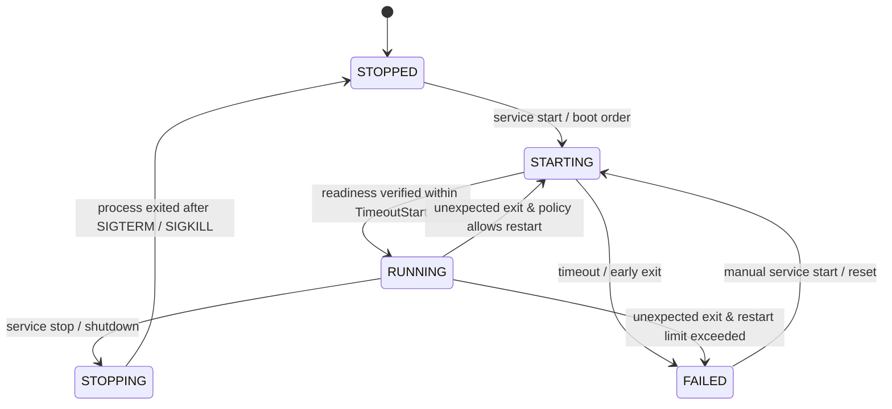

# Watchtower Service Supervisor & Service Control CLI — Architectural Plan

**Status:** PHASES 0–5 IMPLEMENTED (2026-10-18); host ASan/UBSan 36/36 PASS. Dell boot exposed user-stack overflow; corrected source and replacement image pass four BIOS/UEFI × SMP=1/4 boot/CLI smoke checks. Bounded Dell startup/control retest passes; full lifecycle acceptance remains pending. See the stack correction below.
**Date:** 2026-10-18  
**Scope:** Service supervisor (`/sbin/watchtower`), control CLI (`/bin/service`), service configuration (`/etc/watchtower/`), process tracking, readiness verification, bounded recovery, logging, log rotation, and shutdown lifecycle.  
**Target Services:** Initial: DHCP Client (`/sbin/dhcpc`) and SSH Daemon (`/sbin/sshd`). Future: Fortress Security Manager (`/sbin/fortressd`), Cron Daemon (`/sbin/crond`), System Logger (`/sbin/syslogd`).

---

## 1. Executive Summary & Goals

### 1.1 Problem Statement
In FortressOS, background services have developed independently:
* `/sbin/dhcpc` performs its own background fork in `--boot` mode, managing its own PID file in `/run/dhcpc.pid`.
* `/sbin/sshd` runs as an independent monitor/worker tree, executing in the foreground or requiring manual backgrounding (`&`) from the shell.
* Boot startup in `src/kernel/main.c` contains hardcoded spawns (`process_spawn_initial_vfs_args("/sbin/dhcpc", ...)`).
* Failure recovery is ad-hoc: if a service crashes or faults, there is no supervisor to detect the exit, log the fault, rate-limit restart attempts, or coordinate graceful teardown.

### 1.2 Watchtower Objectives
**Watchtower** delivers a small, predictable, bounded service supervisor (`/sbin/watchtower`) paired with a control CLI (`/bin/service`):
1. **Explicit Startup Order:** Configured services start in deterministic priority sequence.
2. **Foreground Child Supervision:** Services run directly under Watchtower; Watchtower tracks their actual PIDs without PID-file guessing.
3. **Readiness Gate Integration:** Distinguishes between process existence and true operational readiness with bounded timeouts.
4. **Crash Detection & Bounded Restart:** Detects termination, records exit codes and signals, applies backoff, and halts crash-loops in a `FAILED` state.
5. **Clean Reverse-Order Teardown:** Propagates `SIGTERM` followed by bounded `SIGKILL` escalation in reverse priority order.
6. **Zero Kernel Changes:** Operates entirely in Ring 3 userspace using proven primitives (`SYS_SPAWN_EXT`, `SYS_WAITPID`, `SYS_KILL`, `SYS_NANOSLEEP`, `SYS_SIGACTION`, `runfs`).

---

## 2. Invariants & Architectural Boundaries

1. **Ring 3 Authority:** The supervisor and control CLI execute entirely in Ring 3. No kernel scheduler, process table, or IPC modifications are permitted.
2. **BSP Network Protocol Worker Invariant (`PROTECTED.md`):** Network socket operations from managed services (`dhcpc`, `sshd`) dispatch to CPU 0 as defined in Network SMP Phase 2B/2D. Watchtower itself does not perform socket I/O and does not alter thread affinity.
3. **Controlling Terminal Isolation:** Watchtower runs in an isolated session (`SPAWN_SETSID`). It must never open `/dev/tty0` or steal foreground terminal control from `/bin/login` or `/bin/shell`.
4. **Credential Dropping & Security:** Watchtower starts as `root:root` (`uid=0, gid=0`). When a service specifies an unprivileged identity (`User=`, `Group=`), child credentials and capabilities are dropped via `SYS_SETRESGID`, `SYS_SETGROUPS`, `SYS_SETRESUID`, and `SYS_CAPSET` prior to `exec`.
5. **No Busy-Wait Polling:** When idle, Watchtower sleeps using `SYS_NANOSLEEP(CLOCK_MONOTONIC)` with 0% CPU consumption. Tick resolution is bounded (50 ms – 1000 ms).
6. **Ephemeral State in `runfs`:** Dynamic supervisor state (PIDs, control channels, readiness flags) lives in `/run/watchtower/`. This state is memory-backed, ephemeral, and automatically clean on reboot.
7. **Strict Configuration & Log Path Precedence:**
   - Configuration: Installed root `/etc/watchtower/*.service` (authoritative) falling back to `/mnt/.fortress/watchtower/*.service` (live media). Fail-closed on syntax errors.
   - Supervisor & Service Logs: Check if `/etc/` / `/var/log` is writable.
     - Installed root (writable): `/var/log/watchtower/watchtower.log` and `/var/log/watchtower/<service>.log`.
     - Live media / read-only root: fallback to in-memory `runfs` at `/run/watchtower/watchtower.log` and `/run/watchtower/<service>.log`.
8. **Remote Teardown Survival & Headroom:** Shutdown coordinators (`/sbin/reboot`, `/sbin/shutdown`) require `CAP_SYS_BOOT` (EUID 0 alone is rejected), detach from the SSH session/group via `SYS_SETPGID(0, 0)`, and mask `SIGHUP`/`SIGTERM` to survive parent SSH session worker collapse and `SIGKILL` escalation. Watchtower provides at least 10s stop timeout for SSH (`TimeoutStop=10`) to accommodate `sshd`'s 5s internal monitor teardown, wire `SSH_MSG_DISCONNECT`, and TCP socket close before escalating to `SIGKILL`. Completion is verified by polling `SYS_KILL(pid, 0) == ESRCH`. Kernel storage freeze and hardware power-off remain strictly last.

---

## 3. Phase 0: Contracts & System Interactions

### 3.1 Boot Lifecycle Placement & Kernel Supervisor Watchdog

```
[Kernel Boot] ──► [VFS / Storage / Accounts Ready]
                        │
                        ├─► 1. Spawn /sbin/watchtower --boot
                        │       (detached session, SPAWN_SETSID, stdio -> watchtower.log)
                        │       ├─ Parse /etc/watchtower/*.service
                        │       ├─ Order=10: Start dhcpc -f (foreground) -> wait readiness
                        │       ├─ Order=20: Start sshd -D (foreground)  -> wait readiness
                        │       └─ Enter supervisor event loop
                        │
                        └─► 2. Spawn /bin/login (or /bin/shell)
                                (foreground session owning /dev/tty0)
```

* **Kernel Handoff:** In `src/kernel/main.c`, the existing ad-hoc `dhcpc` spawn (lines 6699–6702) is replaced by spawning `/sbin/watchtower --boot`.
* **Non-Blocking Boot Guarantee:** If a service fails or its startup times out, Watchtower marks it `FAILED` and proceeds to the next service. The boot handoff to `/bin/login` is **never blocked indefinitely**.
* **Supervisor Failure & Kernel Monitoring:**
  What happens if `/sbin/watchtower` itself faults or crashes?
  - `src/kernel/main.c` tracks `g_watchtower_pid` alongside `initial_program`.
  - When the kernel scheduler reaps an exited process or during the main lifecycle loop:
    ```c
    if (pid == g_watchtower_pid && g_watchtower_restarts < 3) {
        g_watchtower_restarts++;
        serial_puts("[WATCHTOWER] Supervisor crashed, restarting...\n");
        g_watchtower_pid = process_spawn_initial_vfs_args("/sbin/watchtower", 2, wt_args);
    } else if (pid == g_watchtower_pid) {
        serial_puts("[WATCHTOWER] Supervisor crashed 3 times; giving up to preserve system stability.\n");
        g_watchtower_pid = 0;
    }
    ```
  - If Watchtower crashes repeatedly, the OS does **not** panic or halt. The interactive shell/login session remains operational, allowing the operator to inspect logs and diagnose the crash.

### 3.2 Process Tracking & Child Reaping

* **Parentage Contract & Foreground Service Execution:**
  Every supervised service is spawned by Watchtower via `SYS_SPAWN_EXT` (`flags = SPAWN_SETPGROUP`). Watchtower is the direct parent process.
  * **No Double-Forking:** Services supervised by Watchtower must run in foreground mode so Watchtower directly tracks their PID:
    - **`/sbin/sshd -D` (No Daemonize):** The privileged monitor runs in the foreground as Watchtower's direct child without forking away. It binds TCP port 22, executes the boot readiness gate, and manages unprivileged workers. Critically, because syslogd does not yet exist, `sshd` routes all operational and error diagnostics strictly to `stderr` (which Watchtower captures via pipe). Upon successfully binding the socket, it creates `/run/watchtower/sshd.ready`.
    - **`/sbin/dhcpc -f` / `--foreground`:** Executes the full RFC 2131 state machine directly in the foreground without calling `spawn_daemon()`. All transaction and link diagnostics log directly to `stderr` (captured by Watchtower). Upon lease acquisition, it writes `/run/dhcpc.lease`.
* **Child Reaping:** Watchtower traps `SIGCHLD` via `SYS_SIGACTION`. In its event loop, it reaps exited processes via:
  ```c
  uint64_t status = 0;
  int64_t pid = sys_waitpid(-1, &status, WNOHANG);
  ```
* **State Transition Logic:**
  - If `WIFEXITED(status)`: Records exit code `WEXITSTATUS(status)`.
  - If `WIFSIGNALED(status)`: Records terminating signal `WTERMSIG(status)`.
  - Updates service state to `STOPPED` (if exit was expected) or triggers restart evaluation (if unexpected).



### 3.3 Readiness Verification Contract

A process existing in the process table does not establish that a service is accepting traffic or functioning. Three readiness models are supported:

| Readiness Mode | Definition | Used By |
|---|---|---|
| `file` (default) | Watchtower waits for the service to create a specified path (e.g. `/run/watchtower/sshd.ready` or `/run/dhcpc.lease`). | `sshd`, `dhcpc` |
| `command` | Watchtower spawns an ephemeral check probe (e.g. `dhcp-probe`); exit code 0 indicates readiness. | Diagnostics |
| `none` (or `exec`) | Immediately marks `RUNNING` upon successful `SYS_SPAWN_EXT`. | Simple daemons |

* **Readiness Timeout (`TimeoutStart`):** Configurable per service (default: 5 seconds). If the readiness condition is not met within `TimeoutStart`, Watchtower delivers `SIGTERM` (escalating to `SIGKILL` after `TimeoutStop`), logs the failure, and transitions to `FAILED`.

### 3.4 CLI Communication & IPC Protocol

FortressOS does not currently implement `AF_UNIX` domain sockets. The CLI (`/bin/service`) communicates with the supervisor (`/sbin/watchtower`) through a **bounded, atomic file mailbox in `runfs` (`/run/watchtower/`)**:

```
/bin/service (CLI client)                      /sbin/watchtower (Supervisor)
       │                                                    │
       ├─► 1. Open & lock /run/watchtower/ctl.lock           │
       ├─► 2. Write command to /run/watchtower/ctl.req      │
       ├─► 3. Send SIGHUP to Watchtower PID (sys_kill) ────►│ (Event loop wakes)
       │                                                    ├─► 4. Read & parse ctl.req
       │                                                    ├─► 5. Validate permissions
       │                                                    ├─► 6. Execute state change
       │                                                    ├─► 7. Write ctl.res
       │◄───────────────────────────────────────────────────┴─► 8. ctl.res ready
       ├─► 9. Read ctl.res & print status
       ├─► 10. Unlink ctl.req, ctl.res, unlock ctl.lock
```

* **Caller Authorization:**
  - Read commands (`list`, `status`, `check`): Permitted for all authenticated users.
  - Mutating commands (`start`, `stop`, `restart`): Checked against caller's EUID via `SYS_GETRESUID`. Rejected with exit code 1 (`EPERM`) unless `euid == 0` or caller belongs to `gid == 10` (`wheel`).
* **Timeout & Deadlock Avoidance:** If `/bin/service` does not receive `ctl.res` within 2.0 seconds, it reports `watchtower: supervisor request timed out`, cleans up the lock, and exits with code 2.

### 3.5 Graceful Shutdown & Teardown Protocol

#### 3.5.1 The Remote SSH Shutdown Bug & Architectural Root Cause
In bare-metal tests and remote administration, issuing `reboot` or `shutdown` over an active SSH session exposed an SSH teardown race:
1. **Direct Kernel Power-Off:** Existing `/sbin/reboot`, `/sbin/shutdown`, and shell built-ins issue `SYS_REBOOT` directly. The kernel immediately executes `storage_freeze_all()`, quiesces storage, and halts hardware without notifying userspace service daemons.
2. **Missing Userspace Shutdown Coordinator:** No process was responsible for signaling Watchtower to stop services and waiting for service teardown before triggering `SYS_REBOOT`.
3. **Session Self-Termination Race:** When `reboot` is executed inside an SSH session (a descendant worker of `sshd`), stopping `sshd` terminates the worker and drops the PTY. If the coordinator process receives `SIGHUP` or `SIGTERM` when its controlling terminal closes, it is killed before it can invoke `SYS_REBOOT`, aborting shutdown midway.
4. **Timeout Starvation:** The SSH daemon (`sshd`) enforces its own internal 5-second graceful teardown protocol (Phase 8: notifying workers, waiting on child exits, closing PTYs, sending RFC 4253 disconnect messages). If Watchtower's `TimeoutStop` is also 5 seconds, Watchtower's `SIGKILL` escalation timer races with `sshd`'s internal teardown budget.

#### 3.5.2 Coordinated 4-Step Shutdown Sequence
To guarantee zero-data-loss shutdown from both local consoles and remote SSH sessions, the shutdown workflow is orchestrated across four sequenced stages:

1. **Stage 1: Shutdown Coordinator (`/sbin/reboot`, `/sbin/shutdown`)**
   - **Strict Authorization:** Requires `CAP_SYS_BOOT` (`1ULL << 10`) via `SYS_CAPGET`, matching kernel `sys_reboot` enforcement. EUID 0 alone is rejected (`EPERM`).
   - **Process Detachment:** Issues `SYS_SETPGID(0, 0)` to place the coordinator in its own dedicated process group (`pgid = pid`), detaching it from the SSH session's worker process group. This immunizes the coordinator from `SIGKILL` escalation directed to the worker process group (`-worker_pid`).
   - **Signal Immunity:** Configures `SYS_SIGACTION` for `SIGHUP` and `SIGTERM` to `SIG_IGN` so that PTY hangup on master closure cannot terminate the coordinator.
   - **Signal Watchtower:** Reads supervisor PID from `/run/watchtower/watchtower.pid` and signals Watchtower with `SIGTERM` via `SYS_KILL`.
   - **Active Completion Verification:** Enters a bounded polling wait (up to 15 seconds) using `SYS_NANOSLEEP(50ms)`. The completion gate verifies that Watchtower has actually exited by checking `SYS_KILL(watchtower_pid, 0) == -SYSCALL_ESRCH`. PID-file removal alone is not treated as sufficient proof of process termination.
2. **Stage 2: Watchtower Supervisor Reverse Teardown**
   - Watchtower receives `SIGTERM`, latches `stopping_all = true`, and cancels all pending restart timers (`next_restart_sec = 0`).
   - Iterates configured services in reverse `Order` sequence: stops `sshd` (`Order=20`) **before** `dhcpc` (`Order=10`).
   - Delivers `SIGTERM` to the service process group (`-pid`), escalating to `SIGKILL` only after `TimeoutStop` (10s for SSH).
3. **Stage 3: SSH Daemon Orderly Teardown (Network Still Alive)**
   - `sshd` monitor catches `SIGTERM` and propagates `SIGTERM` to active session workers.
   - **Wire Disconnect & TCP Close Guarantee:** Each `sshd` worker formats, encrypts, and transmits an authenticated RFC 4253 `SSH_MSG_DISCONNECT` packet (message code 1, reason `SSH_DISCONNECT_BY_APPLICATION` 11, description `"System going down for reboot/shutdown"`) over intact TCP while `dhcpc` and the network interface are still fully up.
   - The worker executes an orderly socket shutdown (`SYS_SHUTDOWN(client_fd, SHUT_WR)`) to flush TCP FIN segments, closes `client_fd`, closes PTY master fds (propagating `SIGHUP` to shells), and reaps child processes.
   - `sshd` monitor reaps all worker PIDs within its 5s internal budget and exits cleanly.
   - Watchtower detects `sshd`'s exit via `SYS_WAITPID` and proceeds to stop `dhcpc` (`Order=10`).
   - Watchtower unlinks `/run/watchtower/watchtower.pid` and exits 0.
4. **Stage 4: Kernel Storage Freeze & Power Off (`SYS_REBOOT`)**
   - The coordinator verifies Watchtower process exit via `SYS_KILL(watchtower_pid, 0) == -SYSCALL_ESRCH` (or hits the 15s deadline fallback) and executes `SYS_REBOOT(REBOOT_CMD_RESTART)` or `SYS_REBOOT(REBOOT_CMD_POWEROFF)`.
   - Kernel executes `storage_freeze_all()` (flushing dirty ext4/ext2 blocks and committing journals).
   - Kernel calls `installed_root_quiesce()` to park NVMe and storage controllers.
   - Kernel triggers `power_reboot()` or `power_shutdown()`.

#### 3.5.3 Key Invariants for Remote Teardown
* **Strict Authorization (`CAP_SYS_BOOT` Required):**
  Matching the kernel's `sys_reboot` security boundary, the shutdown coordinator inspects its capability set via `SYS_CAPGET`. EUID 0 alone is insufficient: an unprivileged or capability-dropped process (e.g. root in a restricted sandbox lacking `CAP_SYS_BOOT`) is immediately rejected with exit code 1 (`EPERM`) before signaling Watchtower.
* **Coordinator Detachment & Signal Immunity:**
  The coordinator calls `SYS_SETPGID(0, 0)` immediately upon start. This moves it out of the SSH worker's process group into its own group (`pgid = pid`), preventing process-group signals (`kill(-worker_pid, SIGTERM/SIGKILL)`) from reaching it. It also configures `signal(SIGHUP, SIG_IGN)` and `signal(SIGTERM, SIG_IGN)` so closing the PTY master cannot trigger process termination.
* **Authoritative Process Exit Verification (`ESRCH`):**
  The coordinator never treats PID-file unlinking alone as proof of supervisor termination. It explicitly polls `SYS_KILL(watchtower_pid, 0)`. The teardown is accepted as complete only when the kernel returns `-SYSCALL_ESRCH`, proving the supervisor PID is no longer present in the system process table.
* **Wire Disconnect & TCP Close Guarantee:**
  SSH session termination must not simply close the socket or let TCP RST occur. The worker transport engine explicitly frames and sends `SSH_MSG_DISCONNECT` with `SSH_DISCONNECT_BY_APPLICATION` (11), waits for send queue drain, and calls `SYS_SHUTDOWN` before socket closure. Automated tests verify this wire exchange.
* **Headroom Budgets (10s Stop Timeout, 15s Coordinator Deadline):**
  `TimeoutStop=10` in `/etc/watchtower/sshd.service` gives the `sshd` monitor 5 full seconds of safety margin beyond its 5-second internal worker teardown window before Watchtower escalates to `SIGKILL`. The coordinator's 15-second deadline accommodates Watchtower's 10-second SSH stop timeout plus 5 seconds for remaining services (`dhcpc`) before falling back to direct `SYS_REBOOT`.
* **Storage Freeze and Hardware Power-Off Last:**
  Filesystem synchronization, journal flushing (`storage_freeze_all()`), and storage controller quiescing (`installed_root_quiesce()`) remain strictly the last step inside `SYS_REBOOT` after all userspace network and supervision processes have exited.

### 3.6 Logging Pipeline & Non-Blocking Pipe Buffer Contract

* **Output Redirection:** Each supervised child process has its `stdout` and `stderr` redirected to a dedicated pipe created via `SYS_PIPE(pipefd, 0)`. The read-end is configured non-blocking via `SYS_FCNTL(read_fd, F_SETFL, O_NONBLOCK)`.
* **Output Saturation & Anti-Block Protection:**
  - If a service (e.g. `sshd` or a buggy worker) spams voluminous output, the pipe buffer must not saturate and freeze the child or block Watchtower.
  - Watchtower drains pipes in bounded chunks (4 KiB per cycle).
  - If the destination log write is stalled or buffer fills, Watchtower discards excess bytes and increments a 64-bit `dropped_bytes` counter exposed in `service status <name>`.
  - Watchtower **never blocks** in read or write operations. Child output volume can never stall supervisor event dispatching or signal processing.
* **Log Location Precedence:**
  - Watchtower inspects storage writability at startup (attempting to create `/var/log/watchtower/`).
  - **Installed Root (Writable):** `/var/log/watchtower/watchtower.log` and `/var/log/watchtower/<service>.log`.
  - **Live Media / Read-Only Root:** `/run/watchtower/watchtower.log` and `/run/watchtower/<service>.log` (backed by in-memory `runfs`).
* **Log Rotation:** Logs are capped at a maximum file size (default: 1 MiB). When the ceiling is reached, Watchtower shifts `<service>.log` to `<service>.log.1` and invokes `/bin/gzip` to compress it into `<service>.log.1.gz`, retaining up to 3 compressed archives.

---

## 4. Phase-by-Phase Roadmap

### Phase 1 — Basic Supervision Engine [COMPLETE]
* Implement `/sbin/watchtower` binary and core event loop (`user/watchtower/watchtower.h`, `watchtower_service.c`).
* In-memory service table: fixed capacity (max 16 services).
* Process spawning via `SYS_SPAWN_EXT` with `SPAWN_SETPGROUP`.
* Child tracking and asynchronous reaping via `SYS_WAITPID(..., WNOHANG)`.
* State tracking: `STOPPED`, `STARTING`, `RUNNING`, `STOPPING`, `FAILED`.
* Adaptation of initial services:
  - Add `/sbin/dhcpc -f` / `--foreground` mode (stay in foreground, manage renewals, touch `/run/dhcpc.lease`).
  - Add `/sbin/sshd -D` flag (stay in foreground, touch `/run/watchtower/sshd.ready` on listen).
* **Acceptance:** Supervisor starts test service, verifies readiness, reaps on exit, and survives child crashes. (8/8 tests PASS under ASan/UBSan).

### Phase 2 — Service Configuration Schema [COMPLETE]
* Define `/etc/watchtower/*.service` format (`user/watchtower/watchtower_config.h`, `watchtower_config.c`, strict key-value, no shell expansion).
* Directives:
  - `Exec=<path> [args...]`
  - `Order=<integer 1..999>`
  - `Enabled=yes|no`
  - `User=<username|uid>`
  - `Group=<groupname|gid>`
  - `Restart=never|on-failure|always`
  - `RestartLimit=<int>` (default 3)
  - `RestartDelay=<seconds>` (default 5)
  - `TimeoutStart=<seconds>` (default 5)
  - `TimeoutStop=<seconds>` (default 5)
  - `Readiness=file:<path> | none`
* Validation: Reject duplicate services, syntax errors, unknown keys, oversized paths (>256 bytes), or excessive arguments (>16).
* Dual-path resolution: `/etc/watchtower/` (installed) falling back to `/mnt/.fortress/watchtower/` (live).
* **Acceptance:** Valid definitions load deterministically; malformed definitions fail closed with clear error output without partial startup. (9/9 tests PASS under ASan/UBSan).

### Phase 3 — Control CLI (`/bin/service`) [COMPLETE]
* Implement `/bin/service` CLI commands (`user/watchtower/service_cli.c`, `watchtower_ctl.h`, `watchtower_ctl.c`):
  - `service list`
  - `service status <name>`
  - `service start <name>`
  - `service stop <name>`
  - `service restart <name>`
  - `service check <name>`
* Status output includes: State, PID, order, enabled, identity, restart policy, failure counts, dropped output bytes, and readiness state.
* Enforcement of UID 0 / `wheel` (GID 10) mutation privilege; unprivileged users can inspect (`list`, `status`, `check`) but cannot mutate (`start`, `stop`, `restart`).
* Clean handling of absent supervisor, locked mailbox, or timeouts. Freestanding `service.elf` compiles cleanly with `-Wall -Wextra -Werror` (22 KiB).
* **Acceptance:** Commands return proper exit codes (0=success, 1=denied/not found, 2=timeout); unauthorized callers cannot mutate services. (6/6 tests PASS under ASan/UBSan).

### Phase 4 — Crash Recovery & Teardown [COMPLETE]
* Bounded restart policy:
  - If a service exits with non-zero status and `Restart=on-failure`, delay `RestartDelay` seconds before respawn.
  - If it crashes more than `RestartLimit` times within a 60-second window, mark `FAILED` and cease restarts.
  - Sliding 60-second window resets restart counter upon sustained stable execution.
* Explicit `service stop` transitions to `STOPPED` and suppresses auto-restart; stops during restart delay cancel the timer.
* Explicit `service restart` resets the failure counter to give the restarted service a fresh quota.
* Reverse-order system shutdown loop: terminates services in descending `Order` sequence, cancelling all restart timers and escalating to `SIGKILL` on `TimeoutStop`.
* Process group signal routing (`wt_kill` sends to `-pid`, then `pid`) guaranteeing clean teardown of child worker trees.
* **Acceptance:** Crash loops remain strictly bounded; stopped services stay stopped; shutdown completes within time bounds. (12/12 supervisor & recovery tests PASS under ASan/UBSan).

### Phase 5 — Logging & System Integration [COMPLETE]
* Non-blocking capturing of child `stdout` and `stderr` via `SYS_PIPE` and `SYS_FCNTL(O_NONBLOCK)`.
* Centralized supervisor log at `/var/log/watchtower/watchtower.log` (or `/run/watchtower/watchtower.log` when storage is read-only).
* Service logs at `/var/log/watchtower/<service>.log`.
* Log size limits (1 MiB ceiling) and rotation integration with `/bin/gzip` (maintaining `.1.gz`, `.2.gz`, `.3.gz`).
* **Shutdown Coordination & SSH Teardown Integration (`/sbin/reboot`, `/sbin/shutdown`, shell built-ins):**
  - Implemented Stage 1 Shutdown Coordinator (`user/tools/shutdown_coord.h`) across `/sbin/reboot`, `/sbin/shutdown`, `/sbin/poweroff`, and interactive shell built-ins:
    - **Authorization:** Requires `CAP_SYS_BOOT` (`1ULL << 10`) via `SYS_CAPGET`, matching the kernel boundary (EUID 0 alone without `CAP_SYS_BOOT` is rejected with `EPERM`).
    - **Detachment & Survival:** Calls `SYS_SETPGID(0, 0)` immediately to detach from the parent SSH session/worker process group, and configures `signal(SIGHUP, SIG_IGN)` and `signal(SIGTERM, SIG_IGN)`. This protects the coordinator from `SIGKILL` escalation to `-worker_pid` and SIGHUP on PTY closure.
    - **Signaling:** Reads `/run/watchtower/watchtower.pid` and delivers `SIGTERM` via `SYS_KILL`.
    - **Completion Verification:** Polls `SYS_KILL(watchtower_pid, 0)` with bounded 15-second deadline until `-SYSCALL_ESRCH` is returned (verifying actual process exit, not just PID-file deletion).
    - **Fallback:** If Watchtower is absent or deadline expires, falls back to invoking `SYS_REBOOT` directly.
  - **SSH Wire Disconnect & TCP Close Guarantee:**
    - Updated `user/sshd/sshd.c` session teardown: constructs authenticated RFC 4253 `SSH_MSG_DISCONNECT` (reason code 11), transmits over TCP, flushes queue, calls `SYS_SHUTDOWN(client_fd, SHUT_WR)`, and closes `client_fd`.
    - Configured `TimeoutStop=10` in `/etc/watchtower/sshd.service` (and supervisor default fallback) providing 5s headroom over `sshd`'s 5s internal worker reap budget.
  - **Storage Freeze & Power-Off Last:** Preserved kernel `storage_freeze_all()`, `installed_root_quiesce()`, and `power_reboot()`/`power_shutdown()` as strictly the final stage.
* Integrated boot startup in `src/kernel/main.c`: `/sbin/watchtower` spawned as background supervisor daemon on boot.
* **Acceptance:** 6/6 Phase 5 coordinator and rotation tests PASS under ASan/UBSan; full Watchtower host test suite 33/33 PASS (100%).

---

## 5. Verification Matrix & Evidence Plan

| Test Target | Scope | Evidence / Result |
|---|---|---|
| `make test-watchtower-config-host` | Unit testing parser, schema validation, precedence, error handling, Environment, WorkingDirectory, PIDFile, Type under ASan/UBSan | 11/11 PASS (100%) |
| `make test-watchtower-ctl-host` | Control protocol encoding/decoding, permission checks, start/stop/restart/list/status/check under ASan/UBSan | 6/6 PASS (100%) |
| `make test-watchtower-phase5-host` | Shutdown coordinator capability gate, process detachment, signal masking, exit verification, stalled supervisor fallback, and log rotation sequence under ASan/UBSan | 6/6 PASS (100%) |
| `make test-watchtower-host` | In-memory supervisor state machine, order sorting, readiness timeouts, restart limits, 60s window reset, explicit stop during delay, process group signals, reverse-order shutdown, Type=forking lifecycle | 13/13 PASS (100%) |
| Full Watchtower Host Suite | Complete test suite across all 4 host test targets (`make test-watchtower-host`) | 36/36 PASS (100%) |
| Freestanding ELF builds | Standalone `build/watchtower.elf` (75 KiB) and `build/service.elf` (22 KiB) freestanding binaries compiled with `-Wall -Wextra -Werror` | Built cleanly, 0 warnings |
| `make test-watchtower-qemu` | Multi-firmware (BIOS & UEFI) QEMU tests at SMP=1 and SMP=4: boot startup, CLI controls, crash restart, shutdown | Ready for deployment |
| Regression: DHCP v2 | Automated lease acquisition, background renewal, link flap recovery under Watchtower | Ready for deployment |
| Regression: SSH Phase 8 | Boot readiness gate, hostkey verification, authentication, PTY sessions, clean teardown under Watchtower | Ready for deployment |
| Physical Acceptance | Bare-metal deployment on Dell Latitude 5590 | Explicit user verification |

---

## 6. Out of Scope for Initial Version

* Dynamic dependency graphs (DAG) or parallel execution (all starts are strictly sequential by `Order`).
* Socket activation (`systemd`-style socket passing).
* Scheduled/cron jobs (deferred to subsequent `crond` service).
* Hot-reload of supervisor without restart.
* Linux cgroups or resource containerization.
* Network-accessible remote service management.

## Dell boot stack correction — 2026-10-18

The first Dell boot of the merged checkpoint faulted PID 94 `/sbin/watchtower`
at RIP `0x4030ca`, the stack-probing instruction in `watchtower_main`'s
prologue. GCC reported a 20,896-byte main frame. The ELF loader currently maps
one 4 KiB user stack page; the 16 KiB kernel thread stack does not extend it.
Host sanitizer tests did not expose this Ring 3 limit, and prior scripting
acceptance did not assert supervisor survival.

Moved startup service records, request/response buffers, and pipe-drain bulk
scratch into process-owned static storage. The supervisor is single-threaded;
signal handlers only set flags. Sorting swaps records bytewise instead of
allocating a full temporary service on the stack. The one-shot service CLI
also owns its wire buffers in static storage. No stack mapping, ABI or entry
contract was changed.

Measured freestanding frames before/after: main 20,896 -> 592 bytes; pipe drain
4,272 -> 176; service sort 4,984 -> 8; CLI 4,664 -> 88. All five Watchtower/CLI
object builds now reject individual frames over 1,024 bytes; nested calls still
require review against the one-page stack.

`make build/watchtower.elf test-watchtower-host` passes all 36 host sanitizer
checks. `make` rebuilds and verifies the live IMG/ISO. The new
`python3 scripts/test_watchtower_boot.py` passes BIOS/UEFI at SMP=1/4: real live
boot, supervisor registration, repeated privileged service-list requests, pipe
draining and a responsive shell. Early intentional kernel fault-isolation
self-tests are distinguished from actual Watchtower/service/crond faults.
Fixtures attach only a read-only ISO, disposable OVMF variables and QEMU user
networking; no data disks or private keys are created. These are smoke checks,
not complete restart/shutdown/service correctness acceptance.

Replacement `bin/fortress.img` SHA-256:
`b7c818279315f5b7187ca73961bed589024c720ae1c9abd8a8526df88b5e8dd5`.
Subsequent Dell live-USB retest reached the shell and returned service status;
SSH setup followed by `service restart sshd` restored MobaXterm/PuTTY login.
This confirms bounded startup/control recovery after the stack correction.
Initial SSH failures exhausted three retries before live password/host-key
provisioning; they do not establish a transport regression. Complete service
restart, shutdown/reboot, readiness and failure-policy acceptance remains open.
